# TUTO code DEM 2D en C++

Code **Méthode des Éléments Discrets (DEM)** pour des disques en 2D.
8 étapes d'implémentation.
Objectif final: faire tomber quelques milliers de disques frottants dans une boîte, simuler l'effondrement d'une colonne granulaire.

Le code reprend volontairement les choix d'implémentation de deux codes DEM :

- [exaDEM](https://github.com/Collab4exaNBody/exaDEM) ;
- [Rockable](https://github.com/richefeu/rockable).
-> voir l'[annexe A](#annexe-a--correspondance-avec-exadem-et-rockable)).

**Notice.** Chaque étape n'ajoute qu'**une seule brique**.
 A chaque étape : code nouveau, explication physique et numérique. 
 1) Ecrire les nouvelles briques dans le fichier de base, 2)compiler, 3) vérifiez les résultats. 
 Le dossier `corriges/` contient la solution complète de chaque étape.

---

## Sommaire

0. [Prerequis](#0-prerequis)
1. [Étape 1 — La particule et l'intégration en temps](#étape-1--la-particule-et-lintégration-en-temps)
2. [Étape 2 — Contact : rebond sur le sol](#étape-2--contact--rebond-sur-le-sol)
3. [Étape 3 — Collision oblique de deux disques](#étape-3--collision-oblique-de-deux-disques)
4. [Étape 4 — Un ensemble de grains dans une boîte](#étape-4--un-ensemble-de-grains-dans-une-boîte)
5. [Étape 5 — Rotation et contact frottant](#étape-5--rotation-et-contact-frottant)
6. [Étape 6 — Liste de Verlet et boîtes englobantes (OBB)](#étape-6--liste-de-verlet-et-boîtes-englobantes-obb)
7. [Étape 7 — Grille de cellules liées](#étape-7--grille-de-cellules-liées)
8. [Étape 8 — Organisation du code et application : effondrement d'une colonne](#étape-8--organisation-du-code-et-application--effondrement-dune-colonne)
- [Annexe A — Correspondance avec exaDEM et Rockable](#annexe-a--correspondance-avec-exadem-et-rockable)
- [Annexe B — Visualisation des résultats](#annexe-b--visualisation-des-résultats)
- [Annexe C — Prolongements](#annexe-c--prolongements)

---

## 0. Prerequis

### A prevoir

- un compilateur C++17 (`g++` ou `clang++`) ;
- un navigateur web pour regarder les animations ;
- optionnellement [ParaView](https://www.paraview.org/) pour une visualisation plus poussée.

### Organisation des fichiers

```
tutoriel-dem2d/
├── TUTORIEL.md          ce document
├── Makefile             compile et lance les corrigés
├── viz/dem_viz.hpp      librairie de visualisation FOURNIE (à ne pas coder)
├── corriges/            solution de chaque étape
│   ├── etape1_chute_libre.cpp
│   ├── ...
│   ├── etape8_effondrement.cpp
│   └── dem2d.hpp        le moteur final, regroupé (étape 8)
└── images/              figures de ce document
```

Travaillez dans un dossier à vous, par exemple `mon_code/`, à côté de `viz/`. Pour compiler votre fichier :

```bash
g++ -O2 -std=c++17 -Wall -I../viz mon_etape.cpp -o mon_etape
./mon_etape
```

Pour compiler et lancer tous les corrigés d'un coup : `make test` à la racine du dossier.

### Principe de la DEM

En DEM, chaque grain est un objet rigide qui obéit aux lois de Newton. Les grains interagissent seulement quand ils se touchent. On ne résout pas la déformation des grains : on autorise une petite **interpénétration** $\delta_n$ entre deux grains en contact, et on en déduit une force de répulsion (une sorte de ressort). C'est la méthode dite « *soft contact* » de Cundall et Strack (1979).

Un pas de temps typique :

```
répéter :
    1. avancer les positions (et les vitesses d'un demi-pas)   ← intégration en temps
    2. trouver quels objets sont proches                       ← voisins
    3. calculer les forces de contact et les additionner       ← loi de contact
    4. finir d'avancer les vitesses avec les nouvelles forces  ← intégration en temps
```

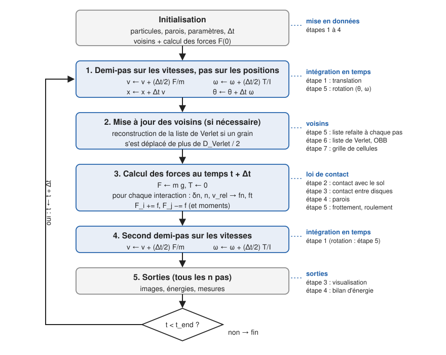

Etapes du tutoriel : on commence par l'intégration en temps (étape 1), loi de contact (étapes 2 à 5), voisins (étapes 6 et 7).

### Unités en 2D

Un disque en 2D représente un cylindre d'épaisseur unité (1 m). Sa masse vaut donc $m = \rho\,\pi r^2$ (en kg/m, c'est-à-dire en kg par mètre d'épaisseur). Les forces sont en N/m, les raideurs en N/m². Le moment d'inertie d'un disque plein vaut $I = \tfrac{1}{2} m r^2$.

---

## Étape 1 — La particule et l'intégration en temps

> **Objectif** : définir la structure qui contient une particule, et faire avancer cette particule dans le temps avec le schéma *velocity Verlet*.
> **Corrigé** : `corriges/etape1_chute_libre.cpp`

### 1.1 Un vecteur 2D

La DEM manipule des vecteurs. Commencez votre fichier par un petit type `Vec2` et les opérations dont on a besoin :

```cpp
#include <cmath>
#include <cstdio>

struct Vec2 {
  double x = 0.0, y = 0.0;
};

inline Vec2 operator+(Vec2 a, Vec2 b) { return {a.x + b.x, a.y + b.y}; }
inline Vec2 operator-(Vec2 a, Vec2 b) { return {a.x - b.x, a.y - b.y}; }
inline Vec2 operator*(double s, Vec2 a) { return {s * a.x, s * a.y}; }
inline Vec2& operator+=(Vec2& a, Vec2 b) {
  a.x += b.x;
  a.y += b.y;
  return a;
}
```

Remarque : Le produit scalaire et la norme seront ajoutés plus tard.

### 1.2 La structure `Particle`

Une particule, c'est une position, une vitesse, et la force qu'elle subit. Il faut aussi sa taille et sa masse :

```cpp
struct Particle {
  Vec2 pos;    // position du centre (m)
  Vec2 vel;    // vitesse (m/s)
  Vec2 force;  // force résultante
  double radius = 0.0;
  double mass = 0.0;
};
```

On garde la **force** dans la particule (et non l'accélération) : pendant le calcul des contacts, chaque contact va *ajouter* sa contribution à `force`. C'est aussi ce que font exaDEM et Rockable.

### 1.3 Le schéma velocity Verlet

On veut résoudre $m\,\ddot{\mathbf x} = \mathbf F$. Le schéma *velocity Verlet* fait avancer positions et vitesses de $t$ à $t+\Delta t$ ainsi :

$$
\mathbf x(t+\Delta t) = \mathbf x(t) + \Delta t\,\mathbf v(t) + \tfrac{\Delta t^2}{2}\,\mathbf a(t),
\qquad
\mathbf v(t+\Delta t) = \mathbf v(t) + \tfrac{\Delta t}{2}\,\big[\mathbf a(t) + \mathbf a(t+\Delta t)\big].
$$
Rq: la vitesse est calculée à partir de l'acceleration moyenne entre t et t + dt

Il est d'ordre 2 et ne demande **qu'un seul calcul de forces par pas**. C'est le schéma utilisé par exaDEM et Rockable.

On l'écrit le plus souvent sous la forme équivalente « *kick – drift – kick* » :

```
v ← v + (Δt/2) F/m        (kick : demi-pas sur la vitesse, avec la force au temps t)
x ← x + Δt v              (drift : pas complet sur la position)
F ← calcul des forces     (forces au temps t + Δt, avec les nouvelles positions)
v ← v + (Δt/2) F/m        (kick : second demi-pas, avec la nouvelle force)
```

> **Exercice 1.1** — Vérifiez sur le papier que ces quatre lignes donnent exactement les deux formules ci-dessus.

> **Remarque** — Rockable écrit la première moitié sous la forme `pos += dt*vel + dt²/2*acc; vel += dt/2*acc;`. C'est la même chose.

### 1.4 Simulation chute libre

Écrivez un `main` qui crée une particule ($r = 1$ cm, $\rho = 2500$ kg/m³), la place en $(0, 1)$ avec une vitesse $(0.5, 0)$, et la fait évoluer sous la seule gravité pendant 400 pas de $\Delta t = 10^{-3}$ s :

```cpp
int main() {
  const Vec2 gravity{0.0, -9.81};
  const double rho = 2500.0;

  Particle p;
  p.radius = 0.01;
  p.mass = rho * M_PI * p.radius * p.radius;
  p.pos = {0.0, 1.0};
  p.vel = {0.5, 0.0};

  const double dt = 1.0e-3;
  p.force = p.mass * gravity;  // force initiale

  for (int step = 0; step <= 400; ++step) {
    // ... afficher t, y et la solution exacte y0 - g t^2 / 2 tous les 50 pas ...

    p.vel += (0.5 * dt / p.mass) * p.force;  // kick
    p.pos += dt * p.vel;                     // drift
    p.force = p.mass * gravity;              // forces au temps t + dt
    p.vel += (0.5 * dt / p.mass) * p.force;  // kick
  }
}
```

### 1.5 Vérification

Vous devez obtenir une erreur de l'ordre de $10^{-15}$, c'est-à-dire la précision machine :

```
# t y y_exact diff
0 1 1 0
0.05 0.987737 0.987738 1.55431e-15
0.1 0.95095 0.95095 4.44089e-16
...
0.4 0.2152 0.2152 2.80331e-15
```

Velocity Verlet est **exact** pour une accélération constante. Si erreur de l'ordre de $\Delta t$,oubli probable l'un des deux demi-pas.

> **Exercice 1.2 facultatif** — Remplacer le schéma par Euler explicite (`pos += dt*vel; vel += dt*force/mass;`). Quelle erreur à $t = 0.4$ s ? Comment varie-t-elle avec $\Delta t$ ?

---

## Étape 2 — Contact : rebond sur le sol

> **Objectif** : écrire la loi de contact normale ressort-amortisseur, choisir ses paramètres et le pas de temps.
> **Corrigé** : `corriges/etape2_rebond.cpp`

### 2.1 Géométrie du contact

Le sol est le plan $y = 0$, de normale unitaire $\mathbf n = (0, 1)$ dirigée **vers la particule**. La distance du centre au sol vaut $d = (\mathbf x - \mathbf x_{sol}) \cdot \mathbf n$, et l'interpénétration est

$$\delta_n = r - d.$$

Il y a contact si et seulement si $\delta_n > 0$.

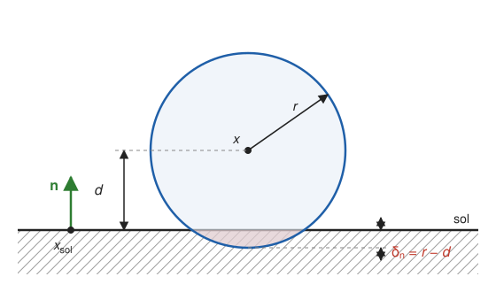

Ajoutez le produit scalaire à vos outils :

```cpp
inline double dot(Vec2 a, Vec2 b) { return a.x * b.x + a.y * b.y; }
```

> **Convention** — Dans ce tutoriel, $\delta_n > 0$ signifie qu'il y a contact. exaDEM et Rockable utilisent la convention inverse (`dn < 0` en contact), d'où des signes « moins » dans leur code (`fne = -kn * dn`).

### 2.2 loi normale : un ressort et un amortisseur

La force normale est celle d'un ressort de raideur $k_n$ en parallèle avec un amortisseur visqueux $c_n$ (modèle de Kelvin-Voigt) :

$$
f_n = k_n\,\delta_n - c_n\,v_n,
\qquad
v_n = \mathbf v_{rel} \cdot \mathbf n,
$$

où $v_n < 0$ quand les objets se rapprochent. L'amortisseur dissipe de l'énergie pendant le choc : il représente tout ce que l'on ne modélise pas (plasticité, vibrations…).

Le contact **n est pas attractif** : si $f_n$ devient négative, on la met à zéro.

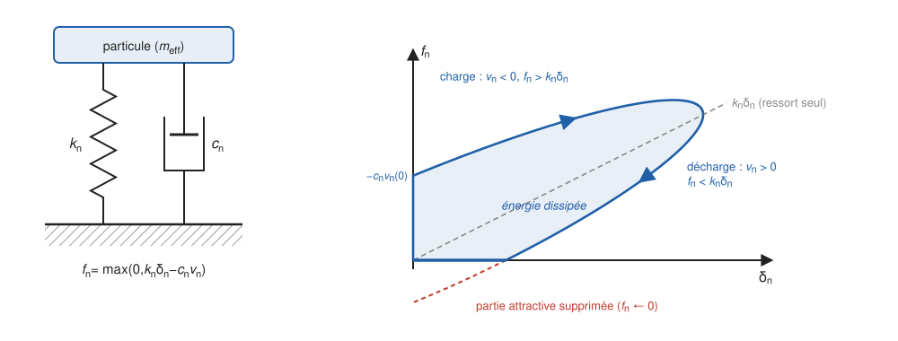

```cpp
const double dist = dot(p.pos - floor_point, floor_normal);
const double overlap = p.radius - dist;
if (overlap > 0.0) {
  const double vn = dot(p.vel, floor_normal);  // < 0 quand la particule s'approche
  double fn = kn * overlap - cn * vn;
  if (fn < 0.0) fn = 0.0;                      // pas de force attractive
  p.force += fn * floor_normal;
}
```

### 2.3 Amortissement à partir du coefficient de restitution

Pendant le contact, $\delta_n$ suit l'équation d'un oscillateur amorti de masse $m_{\text{eff}}$ (ici $m_{\text{eff}} = m$ car le sol est immobile). On écrit l'amortissement sous la forme

$$
c_n = 2\,\zeta\,\sqrt{k_n\,m_{\text{eff}}},
$$

où $\zeta$ est le **taux d'amortissement** (`damp_rate` dans exaDEM). On peut le relier au coefficient de restitution $e$ (rapport des vitesses normales après et avant le choc) en résolvant l'oscillateur :

$$
e = \exp\!\left(-\frac{\zeta\,\pi}{\sqrt{1-\zeta^2}}\right)
\quad\Longleftrightarrow\quad
\zeta = \frac{-\ln e}{\sqrt{\pi^2 + \ln^2 e}}.
$$

```cpp
double damping_ratio_from_restitution(double e) {
  const double le = std::log(e);
  return -le / std::sqrt(M_PI * M_PI + le * le);
}
```

L'intérêt de ce choix : avec $\zeta$ fixé, **le coefficient de restitution est le même pour tous les contacts**, quelles que soient les masses.

### 2.4 Pas de temps

On peut définir un pas de temps critique par  :

$$
t_c = 2 \sqrt{m_{eff}/k_eff} 
$$

(L'amortissement allonge un peu cette durée, d'un facteur $1/\sqrt{1-\zeta^2}$, qu'on néglige ici.)

Deux limites à ne pas confondre :

- **la stabilité** : velocity Verlet devient instable si $\Delta t > 2\sqrt{m/k_n}$. Au-delà, la simulation explose ;
- **la précision** : pour que le choc soit bien décrit, et donc que le coefficient de restitution soit le bon, il faut **plusieurs dizaines de pas par contact**. On prend $\Delta t = t_c / 50$ (entre $t_c/20$ et $t_c/50$ est habituel).

C'est **le contact qui impose le pas de temps**, pas le vol libre. Conséquence : il faut beaucoup de pas pour simuler une durée raisonnable. On ne fixe donc pas le nombre de pas à la main : on choisit la durée simulée $t_{end}$, et on en déduit `nsteps = t_end / dt`. Avec les paramètres ci-dessous, $\Delta t \approx 1{,}1\cdot10^{-5}$ s : la chute de 9 cm (environ 0,135 s) demande à elle seule 12 000 pas.

### 2.5 Raideur

La raideur fixe l'interpénétration typique. Pour un choc à la vitesse $v$, l'interpénétration maximale est de l'ordre de $v\sqrt{m/k_n}$. On veut qu'elle reste petite devant le rayon (de l'ordre de 1 %), sinon le grain n'est plus vraiment rigide. Mais une raideur plus grande impose un pas de temps plus petit ($\Delta t \propto \sqrt{m/k_n}$).

### 2.6 Simulation du rebond


**Paramètres**:

| Paramètre | Valeur |
|---|---|
| rayon $r$ | 0,01 m |
| masse volumique $\rho$ | 2500 kg/m³ |
| hauteur initiale du centre $h_0$ | 0,1 m |
| vitesse initiale | $(0{,}5;\ 0)$ m/s (horizontale, sans effet sur le rebond) |
| raideur $k_n$ | $10^7$ |
| coefficient de restitution $e$ | 0,5 |
| pas de temps | $\Delta t = t_c / 50$ |
| durée simulée $t_{end}$ | 0,5 s, soit `nsteps = t_end / dt` (environ 44 600 pas) |

```cpp
// ===================== PARAMÈTRES (à modifier) ========================
const double radius = 0.01;     // rayon (m)
const double rho = 2500.0;      // masse volumique (kg/m^3)
const double h0 = 0.1;          // hauteur initiale du centre (m)
const double v0 = 0.5;          // vitesse initiale horizontale (m/s)
const double kn = 1.0e7;        // raideur normale
const double re = 0.5;          // coefficient de restitution visé
const double t_end = 0.5;       // durée simulée (s)
const double dt_factor = 50.0;  // nombre de pas de temps par contact
// ======================================================================
const Vec2 gravity{0.0, -9.81};
const Vec2 floor_point{0.0, 0.0};   // le sol est le plan y = 0 ...
const Vec2 floor_normal{0.0, 1.0};  // ... de normale dirigée vers le haut
```


**1. fonction pour la force.** Écrivez une fonction qui renvoie la force totale (gravité + contact) pour une position et une vitesse données :

```cpp
Vec2 compute_force(const Particle& p, double cn) {
  Vec2 f = p.mass * gravity;
  const double overlap = p.radius - dot(p.pos - floor_point, floor_normal);
  if (overlap > 0.0) {
    const double vn = dot(p.vel, floor_normal);  // < 0 quand la particule descend
    double fn = kn * overlap - cn * vn;
    if (fn < 0.0) fn = 0.0;                      // le contact ne tire pas
    f += fn * floor_normal;
  }
  return f;
}
```

**2. boucle en temps** ne change pas par rapport à l'étape 1. Seul le calcul des forces au temps $t+\Delta t$ appelle maintenant `compute_force` :

```cpp
p.force = compute_force(p, cn);           // force initiale
for (int step = 1; step <= nsteps; ++step) {
  p.vel += (0.5 * dt / p.mass) * p.force;
  p.pos += dt * p.vel;
  p.force = compute_force(p, cn);         // forces au temps t + dt, contact compris
  p.vel += (0.5 * dt / p.mass) * p.force;
  // ... mesures ...
}
```

**3. Mesurer le coefficient de restitution.** Après chaque pas, recalculez l'interpénétration. Un booléen `in_contact` suffit pour repérer le début d'un contact (on note $v_{in}$) et sa fin (on note $v_{out}$, puis on affiche $-v_{out}/v_{in}$). Gardez aussi l'interpénétration maximale.

### 2.7 Vérification

Avec la troncature $f_n \ge 0$ (corrigé) :

```
# m = 0.7854 kg/m, tc = 5.605e-04 s, dt = 1.121e-05 s, 44603 pas
t = 0.1364 s : v_in = -1.3170, v_out = +0.7262, e = 0.5514
t = 0.2853 s : v_in = -0.7198, v_out = +0.3971, e = 0.5517
...
e visé = 0.500, interpénétration max / rayon = 2.75e-02
```

Force attractive autorisée (ligne `if (fn < 0.0) fn = 0.0;` mise en commentaire) :

```
t = 0.1364 s : v_in = -1.3170, v_out = +0.6633, e = 0.5037
t = 0.2725 s : v_in = -0.6576, v_out = +0.3254, e = 0.4949
...
```

Deux leçons importantes :

1. Sans la troncature, on retrouve exactement le $e$ visé : la formule de $\zeta$ est juste.
2. Avec la troncature $f_n \ge 0$ (qui est physiquement nécessaire), le contact s'ouvre un peu plus tôt, et le rebond est **plus élastique** que prévu. Le $e$ « effectif » d'une simulation DEM n'est donc pas exactement le $e$ de la formule. Gardez-le en tête quand vous calibrez un matériau.


---

## Étape 3 — Collision oblique de deux disques

> **Objectif** : passer de un à plusieurs disques, en introduisant les structures qui décrivent le système et la loi de contact entre deux disques.
> **Corrigé** : `corriges/etape3_collision.cpp`

Cette étape traite un cas simple dont le résultat est connu : deux disques de tailles différentes se heurtent de manière oblique, sans gravité. Ce cas permet de valider la loi de contact entre deux particules avant de l'utiliser sur un grand nombre de grains (étape 4).

### 3.1 Les outils vectoriels complémentaires

On ajoute au fichier l'en-tête `<vector>`, l'opérateur `-=` et la norme d'un vecteur :

```cpp
#include <vector>

inline Vec2& operator-=(Vec2& a, Vec2 b) {
  a.x -= b.x;
  a.y -= b.y;
  return a;
}
inline double norm(Vec2 a) { return std::sqrt(dot(a, a)); }
```

### 3.2 Les structures `Params` et `System`

À l'étape 2, les paramètres étaient des constantes globales et la simulation ne contenait qu'une particule. Pour la suite, on regroupe :

- les **paramètres du modèle** dans une structure `Params` ;
- l'**état de la simulation** (la liste des particules et les paramètres) dans une structure `System`.

```cpp
struct Params {
  Vec2 gravity{0.0, -9.81};
  double kn = 1.0e7;       // raideur normale
  double damp_rate = 0.0;  // taux d'amortissement zeta (nom utilisé dans exaDEM)
  double dt = 1.0e-5;      // pas de temps
};

struct System {
  std::vector<Particle> particles;
  Params prm;
};
```

Toutes les fonctions qui suivent reçoivent le système (ou ses paramètres) en argument. Il n'y a donc plus de variable globale à partager entre les fonctions, à l'exception des quelques constantes de la mise en données.

### 3.3 La force normale

La loi ressort-amortisseur de l'étape 2 servira pour tous les types de contact. On l'isole dans une fonction qui ne dépend que de l'interpénétration, de la vitesse normale relative et de la masse effective :

```cpp
// vn = (v_i - v_j).n : négative lorsque les objets se rapprochent
double normal_force(const Params& prm, double overlap, double vn, double meff) {
  const double cn = 2.0 * prm.damp_rate * std::sqrt(meff * prm.kn);
  const double fn = prm.kn * overlap - cn * vn;
  return fn > 0.0 ? fn : 0.0;  // pas de force attractive
}
```

### 3.4 Le contact entre deux disques

Pour deux disques $i$ et $j$ de centres $\mathbf x_i$, $\mathbf x_j$ et de rayons $r_i$, $r_j$ :

- le **vecteur branche** $\mathbf x_i - \mathbf x_j$ définit la normale unitaire $\mathbf n = (\mathbf x_i - \mathbf x_j)/\|\mathbf x_i - \mathbf x_j\|$, orientée de $j$ vers $i$ ;
- l'interpénétration vaut $\delta_n = r_i + r_j - \|\mathbf x_i - \mathbf x_j\|$ ;
- la vitesse normale relative vaut $v_n = (\mathbf v_i - \mathbf v_j)\cdot\mathbf n$ ;
- le mouvement relatif des deux disques est celui d'un oscillateur de **masse effective** $m_{\text{eff}} = m_i m_j / (m_i + m_j)$ ;
- la force exercée sur $i$ vaut $f_n\,\mathbf n$ et, d'après le **principe des actions réciproques**, la force exercée sur $j$ vaut $-f_n\,\mathbf n$.

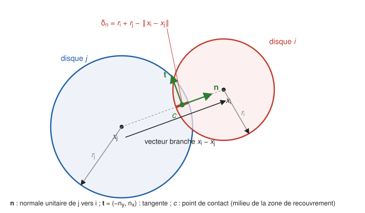

```cpp
void particle_particle(const Params& prm, Particle& pi, Particle& pj) {
  const Vec2 branch = pi.pos - pj.pos;  // vecteur j -> i
  const double dist = norm(branch);
  const double overlap = pi.radius + pj.radius - dist;
  if (overlap <= 0.0) return;  // pas de contact

  const Vec2 n = (1.0 / dist) * branch;  // normale unitaire, de j vers i
  const double vn = dot(pi.vel - pj.vel, n);
  const double meff = pi.mass * pj.mass / (pi.mass + pj.mass);
  const double fn = normal_force(prm, overlap, vn, meff);
  pi.force += fn * n;  // action ...
  pj.force -= fn * n;  // ... et réaction
}
```

### 3.5 Le calcul des forces

On initialise la force de chaque particule à son poids, puis on parcourt **toutes les paires** $(i, j)$ avec $i < j$. Chaque paire n'est traitée qu'une seule fois : la fonction `particle_particle` met à jour les deux particules.

```cpp
void compute_forces(System& sys) {
  auto& P = sys.particles;
  for (auto& p : P) p.force = p.mass * sys.prm.gravity;
  for (size_t i = 0; i < P.size(); ++i)
    for (size_t j = i + 1; j < P.size(); ++j) particle_particle(sys.prm, P[i], P[j]);
}
```

Le nombre de paires testées croît comme $N^2/2$. Ce coût est négligeable pour deux disques, mais il deviendra prohibitif pour quelques milliers de grains ; les étapes 6 et 7 traitent ce point.

### 3.6 Le pas de temps pour l'ensemble des particules

Le schéma velocity Verlet de l'étape 1 s'applique maintenant à chaque particule du système :

```cpp
void exec_one_iter(System& sys) {
  const double dt = sys.prm.dt;
  for (auto& p : sys.particles) {  // demi-pas sur la vitesse, pas complet sur la position
    p.vel += (0.5 * dt / p.mass) * p.force;
    p.pos += dt * p.vel;
  }
  compute_forces(sys);             // forces au temps t + dt
  for (auto& p : sys.particles)    // second demi-pas sur la vitesse
    p.vel += (0.5 * dt / p.mass) * p.force;
}
```

> **Remarque** — `compute_forces` doit être appelé une fois **avant** la boucle en temps, afin que `force` contienne la force au temps initial lors du premier demi-pas.

Une petite fonction utilitaire simplifie la création des disques :

```cpp
Particle make_disk(Vec2 pos, Vec2 vel, double radius, double rho) {
  Particle p;
  p.pos = pos;
  p.vel = vel;
  p.radius = radius;
  p.mass = rho * M_PI * radius * radius;
  return p;
}
```

Le pas de temps est calculé à partir de la formule de la section 2.4, traduite par une fonction :

```cpp
// Pas de temps : une fraction de la durée de contact pour la plus petite masse
double critical_time(double mmin, double kn) { return 2.0 * std::sqrt(mmin / kn); }
```

### 3.7 Mise en données

| Paramètre | Valeur |
|---|---|
| masse volumique $\rho$ | 2500 kg/m³ |
| disque 1 | rayon 10 mm, centre $(0, 0)$, vitesse $(1, 0)$ m/s |
| disque 2 | rayon 5 mm, centre $(0{,}05;\ 0{,}008)$ m, vitesse $(-0{,}5, 0)$ m/s |
| gravité | nulle |
| raideur $k_n$ | $10^7$ |
| coefficient de restitution $e$ | 0,8 |
| pas de temps | $\Delta t = t_c/50$, avec $t_c = 2\sqrt{m_{\text{eff}}/k_n}$ |
| durée simulée | 0,5 s |

Le décalage vertical de 8 mm entre les centres rend le choc oblique.

```cpp
// ===================== PARAMÈTRES ====================================
const double rho = 2500.0;      // masse volumique (kg/m^3)
const double re = 0.8;          // coefficient de restitution visé
const double dt_factor = 50.0;  // nombre de pas de temps par contact
const double t_end = 0.5;       // durée simulée (s)
const int n_save = 40;          // une image tous les n_save pas

int main() {
  System sys;
  sys.prm.gravity = {0.0, 0.0};
  sys.prm.damp_rate = damping_ratio_from_restitution(re);
  sys.particles.push_back(make_disk({0.0, 0.0}, {1.0, 0.0}, 0.010, rho));
  sys.particles.push_back(make_disk({0.05, 0.008}, {-0.5, 0.0}, 0.005, rho));

  // Références vers les deux disques (pour alléger l'écriture)
  const Particle& a = sys.particles[0];
  const Particle& b = sys.particles[1];

  // Pas de temps à partir de la durée de contact
  const double meff = a.mass * b.mass / (a.mass + b.mass);
  sys.prm.dt = critical_time(meff, sys.prm.kn) / dt_factor;
  const int nsteps = static_cast<int>(t_end / sys.prm.dt);
  ...
}
```

> **Remarque** — `a` et `b` sont des **références** : ce sont d'autres noms pour `sys.particles[0]` et `sys.particles[1]`, et non des copies. Elles suivent donc l'évolution des particules au cours du calcul. Elles doivent être déclarées **après** les `push_back`, car l'ajout d'un élément dans un `std::vector` peut déplacer son contenu en mémoire.

### 3.8 Mesures

On souhaite vérifier trois propriétés du choc :

1. la **quantité de mouvement totale** $\sum_i m_i \mathbf v_i$ est conservée ;
2. le rapport des vitesses normales relatives après et avant le choc est proche de $e$ ;
3. la vitesse **tangentielle** relative n'est pas modifiée, puisque le modèle ne comporte pas encore de frottement.

La quantité de mouvement se calcule avec une fonction dédiée :

```cpp
Vec2 total_momentum(const System& sys) {
  Vec2 q;
  for (const auto& p : sys.particles) q += p.mass * p.vel;
  return q;
}
```

Dans la boucle en temps, après chaque pas, on décompose la vitesse relative dans le repère du contact $(\mathbf n, \mathbf t)$, avec $\mathbf t = (-n_y, n_x)$, et on repère le début et la fin du choc avec un booléen :

```cpp
const Vec2 q0 = total_momentum(sys);
compute_forces(sys);
bool was_in_contact = false;
double vn_in = 0.0, vt_in = 0.0;

for (int step = 1; step < nsteps; ++step) {
  exec_one_iter(sys);

  // vitesse relative dans le repère du contact (n, t)
  const Vec2 n = (1.0 / norm(a.pos - b.pos)) * (a.pos - b.pos);
  const Vec2 t{-n.y, n.x};
  const double vn = dot(a.vel - b.vel, n);
  const double vt = dot(a.vel - b.vel, t);

  const bool in_contact = norm(a.pos - b.pos) < a.radius + b.radius;
  if (in_contact && !was_in_contact) {  // début du choc
    vn_in = vn;
    vt_in = vt;
  }
  if (!in_contact && was_in_contact) {  // fin du choc
    const Vec2 q1 = total_momentum(sys);
    std::printf("vn avant = %+.4f, vn après = %+.4f -> e = %.4f\n", vn_in, vn, -vn / vn_in);
    std::printf("vt avant = %+.4f, vt après = %+.4f (inchangée : pas de frottement)\n",
                vt_in, vt);
    std::printf("quantité de mouvement : avant (%.6e, %.6e), après (%.6e, %.6e)\n",
                q0.x, q0.y, q1.x, q1.y);
    break;  // le choc est terminé : inutile de poursuivre
  }
  was_in_contact = in_contact;
}
```

### 3.9 Visualisation

La visualisation est introduite à cette étape. La librairie fournie `viz/dem_viz.hpp` produit des images et une visionneuse ; son contenu n'a pas à être étudié. Le principe est le suivant : on décrit les objets à représenter dans une `viz::Scene` (disques, parois, contacts), puis on transmet cette scène à un `viz::Recorder`, qui écrit une image dans le dossier de sortie.

**1. Inclure la librairie** en tête de fichier :

```cpp
#include "dem_viz.hpp"
```

et compiler avec `-I` suivi du chemin du dossier `viz` :

```bash
g++ -O2 -std=c++17 -Wall -I../viz etape3.cpp -o etape3
```

**2. Créer l'enregistreur** dans `main`, avant la boucle en temps. L'argument est le nom du dossier de sortie, créé automatiquement :

```cpp
viz::Recorder rec("sortie_etape3");
```

**3. Enregistrer une image tous les `n_save` pas**, dans la boucle en temps, après l'appel à `exec_one_iter` :

```cpp
if (step % n_save == 0) {
  viz::Scene scene;
  scene.time = step * sys.prm.dt;
  for (const auto& p : sys.particles)  // x, y, rayon, angle, vx, vy
    scene.disks.push_back({p.pos.x, p.pos.y, p.radius, 0.0, p.vel.x, p.vel.y});
  scene.xmin = -0.02;  // fenêtre affichée (m)
  scene.xmax = 0.07;
  scene.ymin = -0.03;
  scene.ymax = 0.04;
  rec.save(scene);
}
```

Les six valeurs d'un disque sont, dans l'ordre : l'abscisse et l'ordonnée du centre, le rayon, l'angle de rotation (nul tant que les disques ne tournent pas), et les deux composantes de la vitesse, qui servent à la couleur.

**4. Ouvrir le résultat** : le fichier `sortie_etape3/viewer.html` s'ouvre dans un navigateur, et le bouton « Lecture » lance l'animation. La couleur indique la norme de la vitesse (bleu : faible, rouge : élevée). Le dossier contient également des fichiers lisibles par ParaView (voir l'[annexe B](#annexe-b--visualisation-des-résultats)).

| Avant le choc | Contact | Après le choc |
|:---:|:---:|:---:|
| 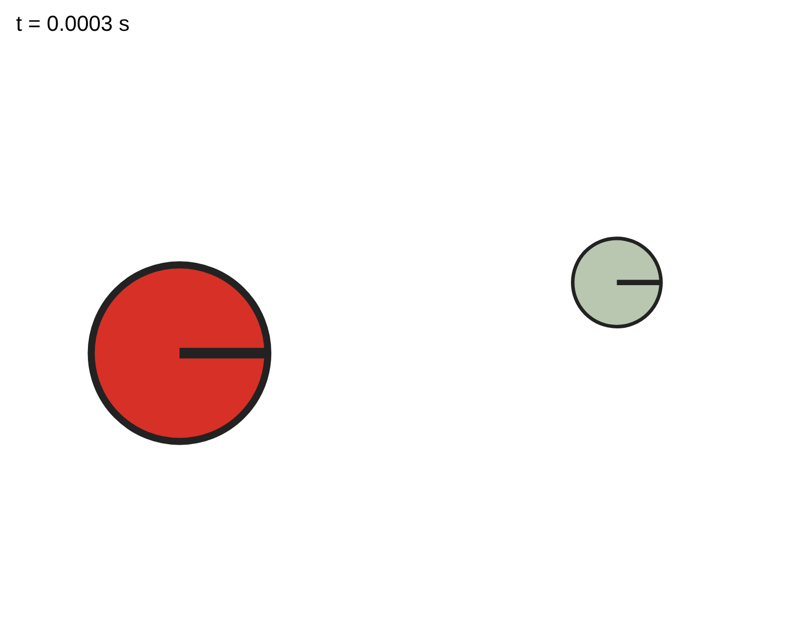 | 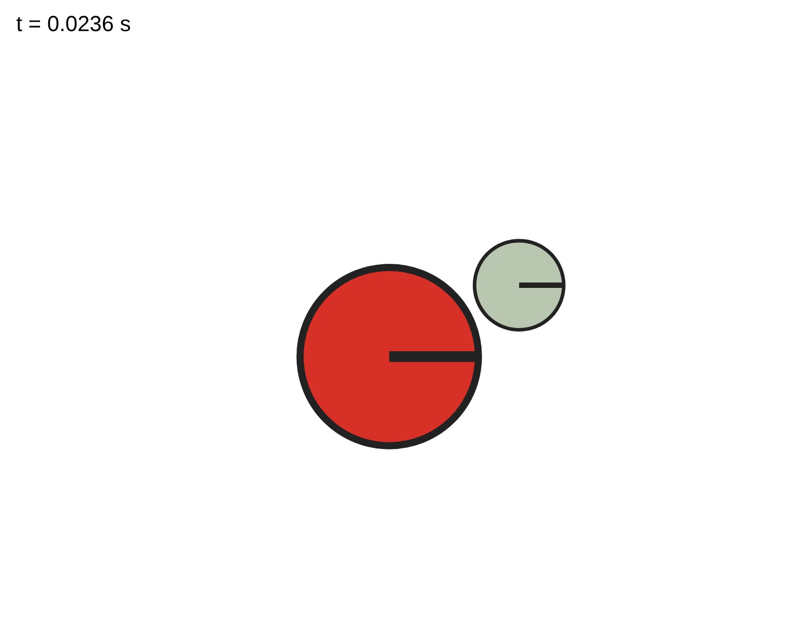 | 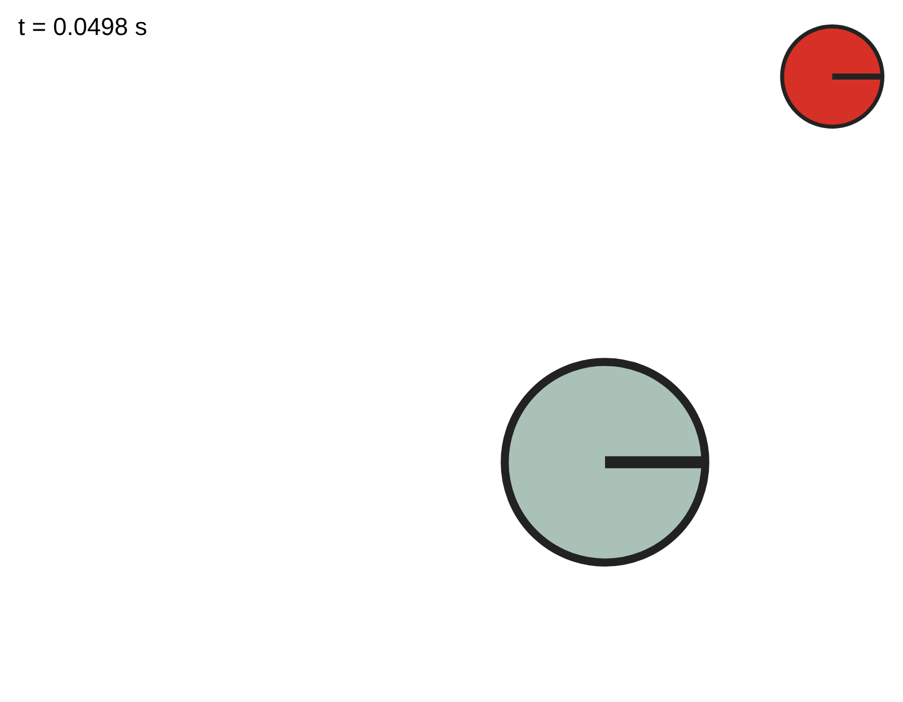 |

### 3.10 Résultats attendus

```
vn avant = -1.2649, vn après = +1.0255 -> e = 0.8108
vt avant = +0.8001, vt après = +0.7997 (inchangée : pas de frottement)
quantité de mouvement : avant (6.872234e-01, 0.000000e+00), après (6.872234e-01, 0.000000e+00)
126 images : ouvrir sortie_etape3/viewer.html
```

- La quantité de mouvement est conservée **à la précision machine**. C'est une conséquence directe de l'écriture symétrique des efforts (`pi.force += …; pj.force -= …;`).
- Le coefficient de restitution mesuré (0,81) est légèrement supérieur à la valeur visée (0,8), pour la raison expliquée à l'étape 2 : la force normale est tronquée à zéro en fin de choc.
- La vitesse tangentielle relative est inchangée, aux erreurs de mesure près : sans frottement, le contact ne transmet aucun effort tangentiel.


---

## Étape 4 — Un ensemble de grains dans une boîte

> **Objectif** : ajouter des parois et simuler la chute d'un ensemble de disques dans une boîte.
> **Corrigé** : `corriges/etape4_boite.cpp`

### 4.1 La structure `Wall`

Une paroi est un plan (une droite en 2D) défini par un point et une normale unitaire **orientée vers le domaine occupé par les grains**. Le système contient maintenant une liste de parois :

```cpp
// Paroi plane infinie : un point et la normale unitaire orientée vers le domaine
struct Wall {
  Vec2 point;
  Vec2 normal;
};

struct System {
  std::vector<Particle> particles;
  std::vector<Wall> walls;
  Params prm;
};
```

### 4.2 Le contact entre un disque et une paroi

C'est le calcul de l'étape 2, écrit pour une paroi quelconque. La paroi est immobile et de masse infinie : la masse effective est celle du disque, et la vitesse relative est celle du disque.

La géométrie est celle de la figure de la section 2.1, où le sol est remplacé par une paroi de point $\mathbf x_p$ (`w.point`) et de normale unitaire $\mathbf n$ (`w.normal`) orientée vers le domaine : $d = (\mathbf x - \mathbf x_p)\cdot\mathbf n$ et $\delta_n = r - d$.

```cpp
void particle_wall(const Params& prm, Particle& p, const Wall& w) {
  const double overlap = p.radius - dot(p.pos - w.point, w.normal);
  if (overlap <= 0.0) return;
  const double vn = dot(p.vel, w.normal);
  const double fn = normal_force(prm, overlap, vn, p.mass);
  p.force += fn * w.normal;
}
```

Dans `compute_forces`, on ajoute une boucle sur les parois après la boucle sur les paires :

```cpp
  for (auto& p : P)
    for (const auto& w : sys.walls) particle_wall(sys.prm, p, w);
```

### 4.3 Mise en données

| Paramètre | Valeur |
|---|---|
| boîte | sol $y = 0$, murs $x = 0$ et $x = 0{,}1$ m |
| disques | 20 disques de rayon 4 mm, 4 rangées de 5, au repos |
| masse volumique $\rho$ | 2500 kg/m³ |
| raideur $k_n$ | $10^7$ |
| coefficient de restitution $e$ | 0,5 |
| pas de temps | $\Delta t = t_c/50$, avec $m_{\text{eff}} = m/2$ (deux disques identiques) |
| durée simulée | 0,5 s |
| sorties | une image toutes les 5 ms, un bilan d'énergie toutes les 0,05 s |

```cpp
// ===================== PARAMÈTRES ====================================
const double rho = 2500.0;      // masse volumique (kg/m^3)
const double re = 0.5;          // coefficient de restitution visé
const double radius = 0.004;    // rayon des disques (m)
const double width = 0.1;       // largeur de la boîte (m)
const int n_rows = 4;           // nombre de rangées de disques
const int n_cols = 5;           // nombre de disques par rangée
const double t_end = 0.5;       // durée simulée (s)
const double dt_factor = 50.0;  // nombre de pas de temps par contact
const double t_save = 0.005;    // une image toutes les t_save secondes
```

Les parois et les disques sont créés au début de `main`. Chaque rangée est légèrement décalée horizontalement, afin que les disques ne retombent pas exactement les uns sur les autres :

```cpp
System sys;
sys.prm.damp_rate = damping_ratio_from_restitution(re);

// La boîte : un sol et deux murs verticaux
sys.walls.push_back({{0.0, 0.0}, {0.0, 1.0}});     // sol
sys.walls.push_back({{0.0, 0.0}, {1.0, 0.0}});     // mur gauche
sys.walls.push_back({{width, 0.0}, {-1.0, 0.0}});  // mur droit

// Les disques, rangée par rangée
for (int row = 0; row < n_rows; ++row) {
  for (int col = 0; col < n_cols; ++col) {
    const double x = 0.01 + 0.02 * col + 0.002 * row;
    const double y = 0.02 + 0.012 * row;
    sys.particles.push_back(make_disk({x, y}, {0.0, 0.0}, radius, rho));
  }
}

// Pas de temps : contact entre deux disques identiques (m_eff = m / 2)
const double meff = 0.5 * sys.particles[0].mass;
sys.prm.dt = critical_time(meff, sys.prm.kn) / dt_factor;
const int nsteps = static_cast<int>(t_end / sys.prm.dt);
const int n_save = static_cast<int>(t_save / sys.prm.dt);  // pas entre deux images
const int n_print = nsteps / 10;                            // pas entre deux bilans
```

La fonction `critical_time` est celle de l'étape 3.

### 4.4 Bilan d'énergie

L'énergie cinétique et l'énergie potentielle de pesanteur permettent de suivre l'état du système :

```cpp
double kinetic_energy(const System& sys) {
  double ek = 0.0;
  for (const auto& p : sys.particles) ek += 0.5 * p.mass * dot(p.vel, p.vel);
  return ek;
}

double potential_energy(const System& sys) {  // référence : y = 0
  double ep = 0.0;
  for (const auto& p : sys.particles) ep -= p.mass * dot(sys.prm.gravity, p.pos);
  return ep;
}
```

### 4.5 Visualisation

Comme la scène doit maintenant contenir les disques **et** les parois, on écrit une fonction qui copie l'état du système dans une scène :

```cpp
viz::Scene make_scene(const System& sys, double t) {
  viz::Scene scene;
  scene.time = t;
  for (const auto& p : sys.particles)  // x, y, rayon, angle, vx, vy
    scene.disks.push_back({p.pos.x, p.pos.y, p.radius, 0.0, p.vel.x, p.vel.y});
  for (const auto& w : sys.walls)      // un point et la normale
    scene.walls.push_back({w.point.x, w.point.y, w.normal.x, w.normal.y});
  return scene;
}
```

La fenêtre n'est pas précisée : elle est alors calculée automatiquement à partir des disques et des points des parois de la première image.

La boucle en temps complète s'écrit :

```cpp
viz::Recorder rec("sortie_etape4");
compute_forces(sys);
rec.save(make_scene(sys, 0.0));  // état initial

std::printf("# t (s)   Ec (J/m)    Ep (J/m)\n");
for (int step = 1; step < nsteps; ++step) {
  exec_one_iter(sys);
  const double t = step * sys.prm.dt;
  if (step % n_save == 0) rec.save(make_scene(sys, t));
  if (step % n_print == 0) {
    const double ek = kinetic_energy(sys);
    const double ep = potential_energy(sys);
    std::cout << t << " " << ek << " " << ep << std::endl;  // #include <iostream>
  }
}
```

### 4.6 Résultats attendus

```
# t (s)   Ec (J/m)    Ep (J/m)
0.0499982 0.302312 0.634586
0.0999963 0.11971 0.235305
0.149994 0.00832129 0.19483
0.199993 0.00391435 0.178407
0.249991 0.00292879 0.173843
0.299989 0.00108424 0.172894
0.349987 0.000480514 0.17256
0.399985 0.00433687 0.168563
0.449983 0.00214918 0.165638
0.499982 0.00102217 0.165277
101 images : ouvrir sortie_etape4/viewer.html
```

L'énergie potentielle décroît pendant la chute, puis se stabilise lorsque les disques forment un empilement. L'énergie cinétique tend vers zéro : elle est dissipée par l'amortissement visqueux à chaque choc.


> **Exercice 4.1** — Prendre $e = 0{,}99$. Combien de temps faut-il pour que l'empilement se stabilise ?
> **Exercice 4.2** — Sans frottement, l'empilement obtenu est-il stable si l'on supprime un des murs ? Le vérifier en retirant le mur droit à $t = 0{,}5$ s.

---

## Étape 5 — Rotation et contact frottant

> **Objectif** : ajouter la rotation des disques et le frottement entre grains, en conservant la configuration de l'étape 4 (20 disques dans une boîte).
> **Point de départ** : votre fichier de l'étape 4.
> **Corrigé** : `corriges/etape5_frottement.cpp` ; cas tests analytiques : `corriges/etape5_tests.cpp`

Cette étape contient l'essentiel de la loi de contact « Hooke » d'exaDEM et de la loi « Default » de Rockable. La section 5.1 présente la théorie ; la section 5.2 détaille, pas à pas, les modifications à apporter au fichier de l'étape 4.

### 5.1 Théorie

#### 5.1.1 La loi de Newton en rotation

Un disque possède, en plus de ses deux degrés de liberté de translation, un degré de liberté de rotation autour de l'axe $z$. À chaque grandeur de la translation correspond une grandeur de la rotation :

| Translation | Rotation |
|---|---|
| position $\mathbf x$ | angle $\theta$ |
| vitesse $\mathbf v = d\mathbf x/dt$ | vitesse angulaire $\omega = d\theta/dt$ |
| masse $m$ | moment d'inertie $I$ |
| force $\mathbf F$ (`force`) | moment $T$ (`torque`) |
| $m\,d\mathbf v/dt = \mathbf F$ | $I\,d\omega/dt = T$ |

- **Le moment** $T$ mesure la capacité d'une force à faire tourner le disque. Il vaut $T = \mathbf r \times \mathbf f$, où $\mathbf r$ est le bras de levier, du centre au point d'application. Une force appliquée au centre (le poids) ou dirigée vers le centre (la force normale) a un moment nul. Une force tangente au bord (le frottement) fait tourner le disque.
- **Le moment d'inertie** $I$ est la résistance à la mise en rotation, comme la masse est la résistance à la mise en mouvement. Pour un disque plein, $I = \tfrac12 m r^2$.

Conséquence importante : **sans frottement, les disques ne tournent jamais**. C'est pourquoi la rotation n'apparaît qu'à cette étape.

> En 3D, l'orientation est décrite par un quaternion et l'intégration de la rotation est plus délicate (voir `Particles[i].Q` dans Rockable). En 2D, un angle suffit.

#### 5.1.2 Vitesse relative au point de contact

Le frottement dépend du **glissement au point de contact** $\mathbf c$, et non de la vitesse des centres : deux disques qui roulent l'un sur l'autre ne glissent pas, même si leurs centres se déplacent. Le point de contact est placé au milieu de la zone d'interpénétration :

$$
\mathbf c = \mathbf x_i - \left(r_i - \tfrac{\delta_n}{2}\right)\mathbf n .
$$

La vitesse du point matériel de $i$ situé en $\mathbf c$ est la somme d'une translation et d'une rotation, $\mathbf v_i + \omega_i\,\mathbf e_z \times (\mathbf c - \mathbf x_i)$ ; il en va de même pour $j$. La vitesse relative est leur différence :

$$
\mathbf v_{rel} = \big[\mathbf v_i + \omega_i\,\mathbf e_z \times (\mathbf c - \mathbf x_i)\big] - \big[\mathbf v_j + \omega_j\,\mathbf e_z \times (\mathbf c - \mathbf x_j)\big].
$$

Elle se décompose en une partie normale $v_n = \mathbf v_{rel}\cdot\mathbf n$ (rapprochement ou éloignement, utilisée par l'amortisseur) et une partie tangentielle $\mathbf v_t = \mathbf v_{rel} - v_n\,\mathbf n$ (glissement, utilisée par le frottement). Cette dernière égalité exprime simplement que l'on retire à $\mathbf v_{rel}$ sa projection sur $\mathbf n$ ; on obtient $\mathbf v_t = (\mathbf v_{rel}\cdot\mathbf t)\,\mathbf t$, avec $\mathbf t = (-n_y, n_x)$.

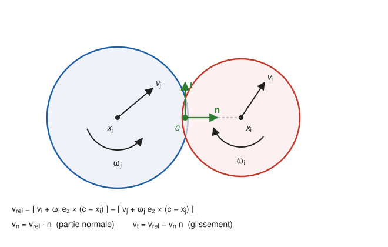

#### 5.1.3 Force tangentielle : ressort et seuil de Coulomb

Le modèle de frottement est celui de Cundall et Strack, utilisé par exaDEM et Rockable. Il associe un ressort tangentiel et un patin frottant (figure ci-dessous, a) :

1. **Phase élastique (adhérence)** : un ressort de raideur $k_t$ s'oppose au déplacement tangentiel relatif $u_t$ accumulé depuis le début du contact : $\mathbf f_t = -k_t\,\mathbf u_t$.
2. **Seuil de Coulomb (glissement)** : la norme de la force tangentielle ne peut excéder $\mu$ fois la force normale. Lorsque ce seuil est atteint, le contact glisse et la force tangentielle reste égale au seuil (figure b, palier).

Le critère $\|\mathbf f_t\| \le \mu\,f_n$ définit un cône dans le plan $(f_n, f_t)$ (figure c) : à l'intérieur, le contact adhère ; sur le bord, il glisse.

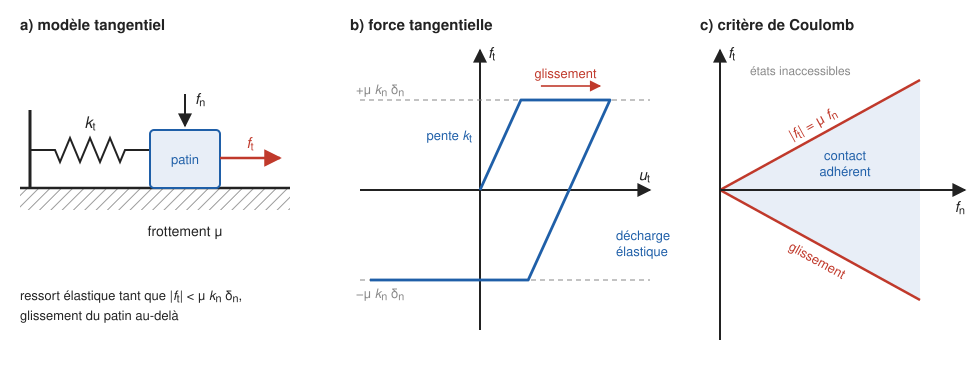

**Écriture incrémentale.** Contrairement à $\delta_n$, le déplacement tangentiel $\mathbf u_t = \int \mathbf v_t\,dt$ ne se lit pas dans les positions actuelles : il dépend de l'histoire du contact. On l'accumule donc pas à pas, en stockant directement la force :

$$
\mathbf f_t \leftarrow \mathbf f_t - k_t\,\mathbf v_t\,\Delta t,
\qquad
\text{si } \|\mathbf f_t\| > \mu\,k_n\,\delta_n \text{ alors } \mathbf f_t \leftarrow \mu\,k_n\,\delta_n\,\frac{\mathbf f_t}{\|\mathbf f_t\|}.
$$

Ramener $\mathbf f_t$ sur le seuil revient à « oublier » la part du déplacement qui a glissé : au pas suivant, le ressort repart de la force plafonnée, ce qui produit naturellement la décharge élastique de la figure (b).

Deux points de mise en œuvre sont repris d'exaDEM et de Rockable :

- le seuil utilise la partie **élastique** de la force normale, $k_n\,\delta_n$, et non $f_n$ amortie (voir `compute_threshold_ft` dans exaDEM) ;
- entre deux pas, le repère du contact tourne. L'ancienne force est donc **reprojetée** sur la tangente actuelle $\mathbf t$ avant d'être incrémentée (c'est le rôle de la correction `FT_CORR` de Rockable en 3D).

#### 5.1.4 La mémoire du contact

La force $\mathbf f_t$ au pas $k$ dépend de sa valeur au pas $k-1$ : **le contact possède un historique**. Elle ne peut pas être stockée dans la particule, car une particule a plusieurs contacts, chacun avec sa propre force tangentielle. On introduit donc un nouvel objet, l'**interaction** entre $i$ et $j$, qui existe aussi longtemps que le contact :

- lorsqu'un contact apparaît, on crée une interaction avec $\mathbf f_t = 0$ ;
- tant que le contact dure, $\mathbf f_t$ est mise à jour à chaque pas ;
- lorsque le contact s'ouvre, la mémoire est effacée.

C'est l'organisation de Rockable (`Interaction` avec `ft`, `mom`, `fn`) et d'exaDEM (les interactions stockent `friction` et `moment`).

#### 5.1.5 Force et moment appliqués

La force de contact exercée par $j$ sur $i$ vaut $\mathbf f = f_n\,\mathbf n + \mathbf f_t$. Elle est appliquée en $\mathbf c$ :

- sur $i$ : force $\mathbf f$ et moment $(\mathbf c - \mathbf x_i)\times\mathbf f$ ;
- sur $j$ : force $-\mathbf f$ et moment $(\mathbf c - \mathbf x_j)\times(-\mathbf f)$.

Comme $\mathbf c - \mathbf x_i$ est parallèle à $\mathbf n$, seule la partie tangentielle $\mathbf f_t$ contribue au moment.

#### 5.1.6 Le pas de temps complet

L'intégration de la rotation utilise le même schéma velocity Verlet que la translation, en remplaçant $m$ par $I$ et $\mathbf F$ par $T$. Un pas de temps devient :

1. demi-pas sur $\mathbf v$ et $\omega$, pas complet sur $\mathbf x$ et $\theta$ ;
2. mise à jour de la liste des interactions, en conservant la mémoire des contacts existants ;
3. calcul des forces **et des moments** ;
4. second demi-pas sur $\mathbf v$ et $\omega$.

### 5.2 Implémentation pas à pas

On part du fichier de l'étape 4. Chaque modification est indiquée dans l'ordre du fichier.

#### 5.2.1 Outils vectoriels

Ajouter, après les opérateurs existants, l'opposé d'un vecteur (nécessaire pour la réaction $-\mathbf f$) et les deux produits vectoriels du plan :

```cpp
inline Vec2 operator-(Vec2 a) { return {-a.x, -a.y}; }

// a x b, pour deux vecteurs du plan : un scalaire (la composante z)
inline double cross(Vec2 a, Vec2 b) { return a.x * b.y - a.y * b.x; }
// w ez x r, pour une rotation w autour de z et un vecteur du plan : un vecteur du plan
inline Vec2 cross(double w, Vec2 r) { return {-w * r.y, w * r.x}; }
```

Le premier `cross` calcule un moment ($\mathbf r \times \mathbf f$), le second la vitesse due à une rotation ($\omega\,\mathbf e_z \times \mathbf r$). C++ distingue les deux versions de `operator-` et de `cross` par le nombre et le type de leurs arguments.

Ajouter également, en tête de fichier, les en-têtes utilisés à l'étape 5.2.5 :

```cpp
#include <map>
#include <tuple>
```

#### 5.2.2 La particule tourne

Compléter `Particle` avec l'angle, la vitesse angulaire, le moment et le moment d'inertie :

```cpp
struct Particle {
  Vec2 pos, vel, force;
  double angle = 0.0;   // rotation (rad)
  double omega = 0.0;   // vitesse angulaire (rad/s)
  double torque = 0.0;  // moment résultant
  double radius = 0.0, mass = 0.0, inertia = 0.0;
};
```

et calculer le moment d'inertie dans `make_disk` :

```cpp
p.inertia = 0.5 * p.mass * radius * radius;
```

> **Attention** — Si `inertia` n'est pas initialisé, il vaut 0 et `torque / inertia` produit des valeurs infinies dès le premier contact.

#### 5.2.3 Paramètres du frottement et structure `Interaction`

Ajouter à `Params` :

```cpp
double kt = 0.8e7;  // raideur tangentielle
double mu = 0.5;    // coefficient de frottement
```

Créer la structure qui porte la mémoire d'un contact, et la liste correspondante dans `System` :

```cpp
// Une interaction entre la particule i et un objet j
// (une autre particule, ou une paroi si wall == true).
struct Interaction {
  int i = 0;
  int j = 0;
  bool wall = false;
  Vec2 ft;           // force tangentielle : c'est la MÉMOIRE du contact
  double mom = 0.0;  // moment de résistance au roulement (section 5.5)
  double fn = 0.0;   // force normale (gardée pour la visualisation)
  Vec2 contact;      // point de contact (pour la visualisation)
};

struct System {
  std::vector<Particle> particles;
  std::vector<Wall> walls;
  std::vector<Interaction> interactions;
  Params prm;
  double time = 0.0;
};
```

Le booléen `wall` est nécessaire : l'indice `j` désigne une particule ou une paroi selon sa valeur.

#### 5.2.4 La loi de contact

La fonction `normal_force` de l'étape 4 est remplacée par une fonction qui calcule les deux parties de la force. Elle ne connaît pas les particules : elle reçoit la géométrie du contact et met à jour la mémoire `ft` (passée par référence) :

```cpp
Vec2 contact_force(const Params& prm, double dn, Vec2 n, Vec2 vrel, double meff, Vec2& ft,
                   double& fn) {
  // --- partie normale : ressort + amortisseur, sans attraction
  const double damp = prm.damp_rate * 2.0 * std::sqrt(prm.kn * meff);
  const double vn = dot(vrel, n);
  fn = prm.kn * dn - damp * vn;
  if (fn < 0.0) fn = 0.0;

  // --- partie tangentielle : ressort incrémental
  const Vec2 t{-n.y, n.x};
  ft = dot(ft, t) * t;                 // on ramène ft dans le plan tangent actuel
  const Vec2 vt = vrel - vn * n;
  ft -= (prm.kt * prm.dt) * vt;        // incrément élastique

  // --- seuil de Coulomb
  const double threshold = prm.mu * prm.kn * dn;
  const double ft_norm = norm(ft);
  if (ft_norm > threshold) ft = (threshold / ft_norm) * ft;

  return fn * n + ft;                  // force exercée par j sur i
}
```

Les trois blocs correspondent aux sections 5.1.3 (partie normale inchangée depuis l'étape 2, ressort tangentiel, seuil de Coulomb).

#### 5.2.5 Contacts disque-disque et disque-paroi

`particle_particle` reçoit désormais l'interaction `I`, calcule le point de contact et la vitesse relative en ce point, puis applique la force **et le moment** aux deux disques. Elle renvoie `false` s'il n'y a pas de contact, pour que la mémoire puisse être effacée :

```cpp
bool particle_particle(const Params& prm, Interaction& I, Particle& pi, Particle& pj) {
  const Vec2 branch = pi.pos - pj.pos;
  const double dist = norm(branch);
  const double dn = pi.radius + pj.radius - dist;
  if (dn <= 0.0) return false;

  const Vec2 n = (1.0 / dist) * branch;
  const Vec2 c = pi.pos - (pi.radius - 0.5 * dn) * n;
  const Vec2 vi = pi.vel + cross(pi.omega, c - pi.pos);
  const Vec2 vj = pj.vel + cross(pj.omega, c - pj.pos);
  const double meff = pi.mass * pj.mass / (pi.mass + pj.mass);

  const Vec2 f = contact_force(prm, dn, n, vi - vj, meff, I.ft, I.fn);
  pi.force += f;
  pi.torque += cross(c - pi.pos, f);
  pj.force -= f;
  pj.torque += cross(c - pj.pos, -f);
  I.contact = c;
  return true;
}
```

`particle_wall` suit le même modèle. La paroi est un objet $j$ immobile, de masse infinie et sans rotation : la vitesse relative est celle du disque en $\mathbf c$, $m_{\text{eff}} = m$, et il n'y a pas de réaction à appliquer :

```cpp
bool particle_wall(const Params& prm, Interaction& I, Particle& p, const Wall& w) {
  const double overlap = p.radius - dot(p.pos - w.point, w.normal);
  if (overlap <= 0.0) return false;
  const Vec2 n = w.normal;// Normale de la paroi vers la particule
  const Vec2 c = p.pos - (p.radius - 0.5 * overlap) * n; // point de contact
  const Vec2 vrel = p.vel + cross(p.omega, c - p.pos);// vitesse relative de la particule par rapport à la paroi
  const double meff = p.mass; // masse effective pour le contact avec la paroi ici mass de la particule

  const Vec2 f = contact_force(prm, overlap, n, vrel, meff, I.ft, I.fn);
  p.force += f;
  p.torque += cross(c - p.pos, f);// moment de la force par rapport au centre de la particule
  I.contact = c;// mise à jour du point de contact
  return true;
}
```

#### 5.2.6 La liste des interactions

À cette étape, la liste est construite de la manière la plus directe : **à chaque pas**, on teste toutes les paires (comme à l'étape 4) et l'on crée une interaction pour chaque contact. La mémoire des contacts qui existaient au pas précédent est ensuite recopiée.

```cpp
// Recopie la mémoire (ft, mom) des interactions qui existaient déjà.
void transfer_history(const std::vector<Interaction>& old_list,
                      std::vector<Interaction>& new_list) {
  std::map<std::tuple<int, int, bool>, Interaction> memory;
  for (const auto& I : old_list) memory[{I.i, I.j, I.wall}] = I;
  for (auto& I : new_list) {
    auto it = memory.find({I.i, I.j, I.wall});
    if (it != memory.end()) {
      I.ft = it->second.ft;
      I.mom = it->second.mom;
    }
  }
}
Interaction new_interaction(int i, int j, bool wall) {
  Interaction I;
  I.i = i;
  I.j = j;
  I.wall = wall;
  return I;
}

void update_interactions(System& sys) {
  const auto& P = sys.particles;
  std::vector<Interaction> list;
  for (int i = 0; i < (int)P.size(); ++i) {
    for (int j = i + 1; j < (int)P.size(); ++j)
      if (norm(P[i].pos - P[j].pos) < P[i].radius + P[j].radius)
        list.push_back(new_interaction(i, j, false));
    for (int w = 0; w < (int)sys.walls.size(); ++w)
      if (dot(P[i].pos - sys.walls[w].point, sys.walls[w].normal) < P[i].radius)
        list.push_back(new_interaction(i, w, true));
  }
  transfer_history(sys.interactions, list);
  sys.interactions.swap(list);
}
```

Fonctionnement de `transfer_history` :

- une interaction est identifiée par le triplet `(i, j, wall)` : `(3, 0, false)` est le contact entre les disques 3 et 0, `(3, 0, true)` le contact entre le disque 3 et la paroi 0 ;
- l'ancienne liste est rangée dans un dictionnaire (`std::map`) dont la clé est ce triplet ;
- pour chaque interaction de la nouvelle liste, `find` cherche la clé. Si elle est trouvée (`it != memory.end()`), le contact existait au pas précédent et l'on recopie sa mémoire (`it->second` est l'ancienne interaction) ; sinon, c'est un nouveau contact et `ft` reste nul.

Enfin, `swap` échange le contenu des deux vecteurs : la nouvelle liste devient `sys.interactions`.

> **Remarque** — Sans `transfer_history`, `ft` serait remise à zéro à chaque pas : le ressort tangentiel ne pourrait jamais se tendre et il n'y aurait pas de frottement.

#### 5.2.7 Calcul des forces

`compute_forces` remet à zéro les forces **et les moments**, puis parcourt la liste des interactions au lieu de toutes les paires. Lorsqu'un contact s'est ouvert, sa mémoire est effacée :

```cpp
void compute_forces(System& sys) {
  for (auto& p : sys.particles) {
    p.force = p.mass * sys.prm.gravity;
    p.torque = 0.0;
  }
  for (auto& I : sys.interactions) {
    Particle& pi = sys.particles[I.i];
    const bool active = I.wall ? particle_wall(sys.prm, I, pi, sys.walls[I.j])
                               : particle_particle(sys.prm, I, pi, sys.particles[I.j]);
    if (!active) {  // plus de contact : on oublie la mémoire
      I.ft = {0.0, 0.0};
      I.mom = 0.0;
      I.fn = 0.0;
    }
  }
}
```

#### 5.2.8 Le pas de temps

`exec_one_iter` intègre la rotation comme la translation, et met à jour la liste des interactions avant le calcul des forces (section 5.1.6) :

```cpp
void exec_one_iter(System& sys) {
  const double dt = sys.prm.dt;
  for (auto& p : sys.particles) {
    p.vel += (0.5 * dt / p.mass) * p.force;
    p.pos += dt * p.vel;
    p.omega += (0.5 * dt / p.inertia) * p.torque;
    p.angle += dt * p.omega;
  }
  update_interactions(sys);
  compute_forces(sys);
  for (auto& p : sys.particles){ 
    p.vel += (0.5 * dt / p.mass) * p.force;
    p.omega += (0.5 * dt / p.inertia) * p.torque;
  }
}
```

#### 5.2.9 Visualisation

Dans `make_scene`, l'angle des disques est transmis (au lieu de `0.0`), ce qui fait tourner le trait tracé dans chaque disque. On ajoute aussi les contacts actifs, pour visualiser le **réseau des forces** : chaque contact est un segment entre les centres (ou entre le centre et le point de contact pour une paroi), d'épaisseur proportionnelle à $f_n$.

```cpp
viz::Scene make_scene(const System& sys, double t) {
  viz::Scene scene;
  scene.time = t;
  for (const auto& p : sys.particles)  // x, y, rayon, angle, vx, vy
    scene.disks.push_back({p.pos.x, p.pos.y, p.radius, p.angle, p.vel.x, p.vel.y});
  for (const auto& w : sys.walls)      // un point et la normale
    scene.walls.push_back({w.point.x, w.point.y, w.normal.x, w.normal.y});
  for (const auto& I : sys.interactions) {  // contacts actifs : segment + force normale
    if (I.fn <= 0.0) continue;
    const Vec2 a = sys.particles[I.i].pos;
    const Vec2 b = I.wall ? I.contact : sys.particles[I.j].pos;
    scene.contacts.push_back({a.x, a.y, b.x, b.y, I.fn});
  }
  return scene;
}
```

#### 5.2.10 Programme principal

La mise en données est **identique à celle de l'étape 4** (mêmes paramètres, même boîte, mêmes 20 disques). Deux lignes changent :

- le nom du dossier de sortie : `viz::Recorder rec("sortie_etape5");` ;
- la liste des interactions doit être construite **avant** le premier calcul des forces, sans quoi le premier pas ignore les contacts :

```cpp
update_interactions(sys);
compute_forces(sys);
rec.save(make_scene(sys, 0.0));  // état initial
```

La boucle en temps est inchangée.

### 5.3 Résultats attendus

```
# t (s)   Ec (J/m)    Ep (J/m)
0.0499982 0.302312 0.634586
0.0999963 0.157696 0.247941
0.149994 0.0192074 0.190873
0.199993 0.000688458 0.187867
0.249991 0.00137068 0.183552
0.299989 0.0004737 0.182997
0.349987 0.000908698 0.18235
0.399985 0.000490605 0.181781
0.449983 0.000637384 0.180785
0.499982 0.000642461 0.179852
101 images : ouvrir sortie_etape5/viewer.html
```

Jusqu'au premier choc ($t \approx 0{,}05$ s), les résultats sont identiques à ceux de l'étape 4 : en vol libre, le frottement n'intervient pas. Ensuite, l'énergie potentielle finale est plus élevée qu'à l'étape 4 (0,180 contre 0,165 J/m) : grâce au frottement, les disques de la seconde couche ne glissent plus dans les creux de la première, et l'empilement est moins dense.


### 5.4 Validation : cas tests analytiques (Facultatif)

Le programme `corriges/etape5_tests.cpp` vérifie la loi de contact sur trois cas dont la solution est connue :

1. **Du glissement au roulement.** Un disque est lancé à $v_0 = 1$ m/s sur le sol, sans rotation. Le frottement le freine et le met en rotation, jusqu'au roulement sans glissement. La théorie donne une vitesse finale $v_0/(1 + I/mr^2) = \tfrac{2}{3}v_0$, atteinte au temps $v_0/(3\mu g)$.
2. **Plan incliné.** La gravité est inclinée de 20°, ce qui équivaut à incliner le sol. Si $\mu$ est suffisamment grand, le disque roule sans glisser avec l'accélération $a = \tfrac{2}{3}\,g\sin\theta$.
3. **Résistance au roulement** (section 5.5). Un disque qui roule sans glisser à $v_0 = 0{,}5$ m/s, avec $\mu_r = 0{,}1\,r$, décélère de $a = \tfrac{2}{3}\,\mu_r g/r$ et s'arrête après la distance $v_0^2/(2a)$.

```
--- Test 1 : glissement -> roulement ---
v = 0.66747 (théorie 0.66667), w*r = -0.66504, glissement v + w r = 2.43e-03
--- Test 2 : roulement sur un plan incliné à 20 degrés ---
a = 2.2367 m/s^2 (théorie : 2/3 g sin(theta) = 2.2368)
--- Test 3 : freinage par la résistance au roulement ---
arrêt à t = 0.7643 s (théorie 0.7645), distance 0.1911 m (théorie 0.1911)
```

Le faible glissement résiduel du test 1 ($v + \omega r \ne 0$) correspond à l'oscillation du ressort tangentiel, non amorti ici (exaDEM et Rockable n'amortissent pas non plus la partie tangentielle).

### 5.5 Résistance au roulement (facultatif)

Un disque parfait posé sur un sol plan roule indéfiniment : lorsqu'il roule sans glisser, la vitesse relative au point de contact est nulle, la force tangentielle ne s'oppose à rien et aucun moment ne freine la rotation. Les grains réels n'étant pas parfaitement circulaires, Rockable et exaDEM introduisent un **moment de résistance au roulement** $M_r$, construit exactement comme la force tangentielle, en remplaçant les translations par des rotations :

| | Force tangentielle | Moment de roulement |
|---|---|---|
| Grandeur cinématique | vitesse de glissement $\mathbf v_t$ | rotation relative $\Delta\omega = \omega_i - \omega_j$ |
| Incrément élastique | $\mathbf f_t \leftarrow \mathbf f_t - k_t\,\mathbf v_t\,\Delta t$ | $M_r \leftarrow M_r - k_r\,\Delta\omega\,\Delta t$ |
| Seuil | $\mu\,f_n$ | $\mu_r\,f_n$ ($\mu_r$, noté `mur`, est une **longueur**) |
| Mémoire | `I.ft` | `I.mom` |

Cette résistance n'est pas nécessaire pour la boîte de l'étape 5 ; elle le devient à l'étape 8. Son ajout se fait par copier-coller des cinq extraits ci-dessous. Le champ `mom` de `Interaction` existe déjà, et `transfer_history` et `compute_forces` le gèrent déjà : il n'y a rien d'autre à modifier.

**1. Dans `struct Params`**, ajouter deux champs après `mu`. Avec `kr = 0`, la résistance est désactivée et les résultats précédents sont inchangés :

```cpp
  double kr = 0.0;   // raideur en rotation (0 : pas de résistance au roulement)
  double mur = 0.0;  // seuil du moment = mur * fn (mur est une longueur)
```

**2. Après la fonction `contact_force`**, ajouter la fonction suivante. `std::copysign(a, b)` renvoie $|a|$ avec le signe de $b$ :

```cpp
// Résistance au roulement : ressort de torsion incrémental, plafonné à mur * fn.
//   dw : vitesse de rotation de i par rapport à j
double rolling_moment(const Params& prm, double dw, double fn, double& mom) {
  if (prm.kr <= 0.0) return 0.0;  // résistance désactivée
  mom -= prm.kr * dw * prm.dt;    // incrément élastique
  const double threshold = prm.mur * fn;
  if (std::fabs(mom) > threshold) mom = std::copysign(threshold, mom);
  return mom;
}
```

**3. Dans `particle_particle`**, remplacer les lignes qui suivent l'appel à `contact_force` par :

```cpp
  const Vec2 f = contact_force(prm, dn, n, vi - vj, meff, I.ft, I.fn);
  const double m = rolling_moment(prm, pi.omega - pj.omega, I.fn, I.mom);
  pi.force += f;
  pi.torque += cross(c - pi.pos, f) + m;
  pj.force -= f;
  pj.torque += cross(c - pj.pos, -f) - m;
  I.contact = c;
  return true;
```

**4. Dans `particle_wall`**, de même (la paroi ne tourne pas, donc $\Delta\omega = \omega_i$) :

```cpp
  const Vec2 f = contact_force(prm, overlap, n, vrel, meff, I.ft, I.fn);
  const double m = rolling_moment(prm, p.omega, I.fn, I.mom);
  p.force += f;
  p.torque += cross(c - p.pos, f) + m;
  I.contact = c;
  return true;
```

**5. Dans `main`**, activer la résistance en donnant des valeurs aux deux paramètres, par exemple $\mu_r = 0{,}1\,\bar r$ (un dixième du rayon moyen) et $k_r = 0{,}25\,k_n\,r_{min}^2$ :

```cpp
  sys.prm.mur = 0.1 * radius;
  sys.prm.kr = 0.25 * sys.prm.kn * radius * radius;
```

Avec ce choix, le temps caractéristique en rotation $\sqrt{I/k_r}$ est du même ordre que $\sqrt{m/k_n}$ : le pas de temps n'a pas à être modifié.

> **Exercice 5.1** — Prendre $\mu = 0$ et vérifier que les disques ne tournent pas. Comparer l'énergie potentielle finale à celle de l'étape 4.
> **Exercice 5.2** — Avec $\mu = 0{,}5$, retirer le mur droit à $t = 0{,}5$ s (comme à l'exercice 4.2). L'empilement est-il plus stable qu'à l'étape 4 ?
> **Exercice 5.3** — Dans `transfer_history`, supprimer la recopie de `ft`. Que devient l'empilement ?
> **Exercice 5.4** — Prendre $\mu = 0$ dans le cas du plan incliné (`etape5_tests.cpp`). Que devient l'accélération ? La retrouver par le calcul.
> **Exercice 5.5 (facultatif)** — Après avoir ajouté la résistance au roulement, lancer un disque seul sur le sol avec une vitesse horizontale de 0,5 m/s, d'abord avec `kr = 0`, puis avec la résistance. Tracer $v_x(t)$ et $\omega(t)$. Dans le second cas, vérifier que la décélération en régime de roulement vaut $\tfrac{2}{3}\,\mu_r g / r$ pour un disque plein.

---

## Étape 6 — Liste de Verlet et boîtes englobantes (OBB)

> **Objectif** : ne plus reconstruire la liste des interactions à chaque pas, grâce à une liste de Verlet construite à partir de boîtes englobantes orientées.
> **Point de départ** : votre fichier de l'étape 5.
> **Corrigé** : `corriges/etape6_verlet.cpp`

La loi de contact n'est plus modifiée dans la suite. En revanche, `update_interactions` teste toutes les paires à chaque pas : son coût est en $O(N^2)$ par pas. Avec 200 disques, il représente déjà l'essentiel du temps de calcul. Cette étape introduit les deux premières techniques employées par Rockable et exaDEM pour réduire ce coût : la liste de Verlet et les boîtes englobantes. L'étape 7 ajoutera la grille de cellules.

### 6.1 Liste de Verlet

Au cours d'un pas de temps, un grain se déplace d'une distance très inférieure à son rayon ; la liste des voisins évolue donc peu d'un pas à l'autre. Le principe de Verlet (1967) consiste à construire une liste **élargie**, contenant toutes les paires séparées d'une distance inférieure à une marge $D_{Verlet}$, y compris celles qui ne sont pas encore en contact. Ces paires constituent les contacts **candidats**. Tant qu'aucun grain ne s'est déplacé de plus de $D_{Verlet}/2$, aucun nouveau contact ne peut apparaître hors de la liste, qui peut donc être conservée.

Exemple, avec $D_{Verlet} = 0{,}1$ mm :

- deux disques qui se recouvrent sont dans la liste (contact) ;
- deux disques dont les surfaces sont séparées de 0,05 mm sont dans la liste (candidats, sans contact pour l'instant) ;
- deux disques séparés de 1 mm ne sont pas dans la liste.

À chaque pas, `compute_forces` parcourt les candidats et calcule l'interpénétration effective $\delta_n$. Les candidats sans contact renvoient `false` et leur historique reste nul. Les fonctions `compute_forces`, `particle_particle` et `particle_wall` de l'étape 5 ne sont pas modifiées.

Le seuil $D_{Verlet}/2$ s'explique ainsi : lorsque deux grains se rapprochent, la distance qui les sépare diminue au plus de $2\,d_{max}$, où $d_{max}$ est le plus grand déplacement depuis la construction de la liste. La condition est donc $2\,d_{max} < D_{Verlet}$.

On ajoute à `Params` :

```cpp
double DVerlet = 1.0e-4;  // distance de Verlet (marge de la liste de voisins)
```

et à `System` de quoi savoir quand reconstruire :

```cpp
std::vector<Vec2> pos_at_last_build;  // positions lors de la dernière construction
int nb_rebuilds = 0;
```

Le critère de reconstruction :

```cpp
bool need_update(const System& sys) {
  if (sys.pos_at_last_build.size() != sys.particles.size()) return true;
  const double limit2 = 0.25 * sys.prm.DVerlet * sys.prm.DVerlet;
  for (size_t i = 0; i < sys.particles.size(); ++i) {
    const Vec2 d = sys.particles[i].pos - sys.pos_at_last_build[i];
    if (dot(d, d) > limit2) return true;
  }
  return false;
}
```


Fonctionnement de `need_update` :

- `pos_at_last_build` est une « photographie » des positions, prise à la fin de chaque reconstruction de la liste (voir `update_interactions` en 6.3). `need_update` compare la position actuelle de chaque grain à cette photographie ;
- la comparaison porte sur les carrés des distances, $\|\mathbf d\|^2 > (D_{Verlet}/2)^2 = 0{,}25\,D_{Verlet}^2$, ce qui évite une racine carrée ;
- la première ligne traite la toute première construction : au début du programme, `pos_at_last_build` est vide, sa taille diffère de celle de `particles`, et la reconstruction est imposée. Le même test impose une reconstruction si des particules sont ajoutées ou retirées ;
- `nb_rebuilds` est un simple compteur, sans rôle dans le calcul : il permet de vérifier que la liste n'est reconstruite qu'occasionnellement.

> **Rockable** reconstruit plutôt la liste à intervalle fixe (`interVerlet`), avec une option de mise à jour selon le déplacement (`dynamicUpdateNL`, `dispUpdateNL`). Cette approche est moins sûre, mais évite le calcul des déplacements à chaque pas. Le critère sur le déplacement est le plus robuste ; c'est aussi celui des codes de dynamique moléculaire et d'exaDEM (opérateur `particle_displ_over`).

### 6.2 Boîtes englobantes orientées (OBB)

Pour déterminer si une paire est candidate, Rockable et exaDEM ne testent pas la forme exacte des grains, coûteuse pour des polyèdres, mais leur **boîte englobante orientée** (*Oriented Bounding Box*, OBB) élargie de $D_{Verlet}/2$, dont le test d'intersection est peu coûteux.

Pour un disque, l'OBB est le carré circonscrit, qui tourne avec le disque. Dans le cas de disques, le test $\|\mathbf x_i - \mathbf x_j\| < r_i + r_j + D_{Verlet}$ suffirait ; l'OBB est néanmoins conservée car elle se généralise directement à des grains polygonaux.

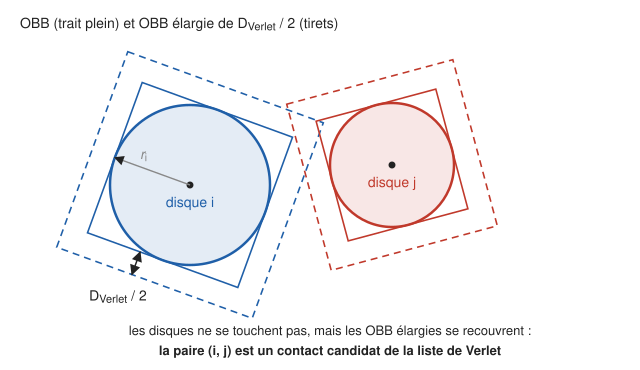

```cpp
struct OBB {
  Vec2 center;
  Vec2 axis[2];                  // deux axes unitaires orthogonaux
  double extent[2] = {0.0, 0.0}; // demi-longueurs selon chaque axe
};

OBB particle_obb(const Particle& p) {
  OBB b;
  b.center = p.pos;
  b.axis[0] = {std::cos(p.angle), std::sin(p.angle)};
  b.axis[1] = {-std::sin(p.angle), std::cos(p.angle)};
  b.extent[0] = b.extent[1] = p.radius;
  return b;
}

void enlarge(OBB& b, double d) {  // comme OBB::enlarge dans Rockable
  b.extent[0] += d;
  b.extent[1] += d;
}
```

Le test d'intersection repose sur le **théorème de l'axe séparateur** : deux boîtes convexes sont disjointes si et seulement s'il existe un axe sur lequel leurs projections sont disjointes. En 2D, il suffit de tester les 4 axes des deux boîtes.

```cpp
// "Rayon" de l'OBB projetée sur une direction unitaire u
double projected_radius(const OBB& b, Vec2 u) {
  return b.extent[0] * std::fabs(dot(b.axis[0], u)) +
         b.extent[1] * std::fabs(dot(b.axis[1], u));
}

bool intersect(const OBB& a, const OBB& b) {
  const Vec2 d = b.center - a.center;
  const Vec2 axes[4] = {a.axis[0], a.axis[1], b.axis[0], b.axis[1]};
  for (const Vec2& u : axes)
    if (std::fabs(dot(d, u)) > projected_radius(a, u) + projected_radius(b, u)) return false;
  return true;
}

// Une OBB touche le demi-plan situé derrière une paroi
bool intersect(const OBB& b, const Wall& w) {
  return dot(b.center - w.point, w.normal) <= projected_radius(b, w.normal);
}
```

> **Exercice 6.1** — Représenter deux carrés tournés de 45° l'un par rapport à l'autre et vérifier le théorème sur les 4 axes.

### 6.3 Liste de Verlet construite par force brute

La liste est construite en testant les OBB élargies de toutes les paires. Le coût reste en $O(N^2)$, mais il n'est payé **que lors des reconstructions**, soit typiquement toutes les quelques dizaines de pas.

```cpp
void build_verlet_list_brute_force(const System& sys, std::vector<Interaction>& list) {
  const auto& P = sys.particles;
  const int n = (int)P.size();
  std::vector<OBB> obb(n);
  for (int i = 0; i < n; ++i) {
    obb[i] = particle_obb(P[i]);
    enlarge(obb[i], 0.5 * sys.prm.DVerlet);
  }
  for (int i = 0; i < n; ++i) {
    for (int j = i + 1; j < n; ++j)
      if (intersect(obb[i], obb[j])) list.push_back(new_interaction(i, j, false));
    for (int w = 0; w < (int)sys.walls.size(); ++w)
      if (intersect(obb[i], sys.walls[w])) list.push_back(new_interaction(i, w, true));
  }
}
```

Cette boucle est identique à celle de `UpdateNL_bruteForce` dans `rockable/src/Core/Rockable.cpp`.

La fonction `update_interactions` devient :

```cpp
void update_interactions(System& sys, bool force_rebuild = false) {
  if (!force_rebuild && !need_update(sys)) return;  // la liste est encore valable

  std::vector<Interaction> list;
  build_verlet_list_brute_force(sys, list);
  transfer_history(sys.interactions, list);  // on garde la mémoire des contacts
  sys.interactions.swap(list);

  sys.pos_at_last_build.resize(sys.particles.size());
  for (size_t i = 0; i < sys.particles.size(); ++i)
    sys.pos_at_last_build[i] = sys.particles[i].pos;
  ++sys.nb_rebuilds;
}
```

L'appel à `transfer_history` est essentiel : lors d'une reconstruction, un contact existant doit retrouver sa force tangentielle. À défaut, le frottement serait réinitialisé à chaque reconstruction et un empilement de grains se mettrait à fluer.


Le paramètre `force_rebuild` permet d'**imposer** la reconstruction, même si `need_update` estime la liste encore valable. Sa valeur par défaut (`false`) permet l'appel `update_interactions(sys)` utilisé à chaque pas. La reconstruction doit être imposée lorsque le système change d'une manière que `need_update` ne détecte pas, par exemple lors de la suppression d'une paroi (étape 8) : aucun grain n'a bougé, mais la liste contient des interactions avec une paroi qui n'existe plus.

### 6.4 Mise en œuvre

On reprend la boîte de l'étape 5, avec davantage de disques : 20 rangées de 10 disques de rayon 4 mm, soit 200 disques.

```cpp
const int n_rows = 20;               // nombre de rangées de disques
const int n_cols = 10;               // nombre de colonnes de disques
...
for (int row = 0; row < n_rows; ++row) {
  for (int col = 0; col < n_cols; ++col) {
    const double x = 0.006 + 0.0095 * col + 0.002 * (row % 2);
    const double y = 0.006 + 0.0095 * row;
    sys.particles.push_back(make_disk({x, y}, {0.0, 0.0}, radius, rho));
  }
}
```

Le décalage `0.002 * (row % 2)` alterne d'une rangée à l'autre, afin que les disques ne retombent pas exactement les uns sur les autres sans sortir de la boîte.

Modifications à apporter au fichier de l'étape 5 :

1. ajouter `DVerlet` à `Params`, `pos_at_last_build` et `nb_rebuilds` à `System` (6.1) ;
2. ajouter la structure `OBB` et les fonctions `particle_obb` et `enlarge` (6.2) ;
3. ajouter `need_update`, `projected_radius`, les deux fonctions `intersect` et `build_verlet_list_brute_force`, puis remplacer `update_interactions` (6.1 à 6.3).

> **Ordre des fonctions** — En C++, une fonction doit être déclarée avant d'être appelée. `need_update` et `build_verlet_list_brute_force` doivent donc figurer **avant** `update_interactions` dans le fichier, et `projected_radius` et `intersect` avant `build_verlet_list_brute_force`. Dans le cas contraire, le compilateur signale `'need_update' was not declared in this scope`.

Enfin, le nombre de reconstructions est affiché en fin de simulation, et le dossier de sortie devient `sortie_etape6` :

```cpp
std::printf("%d reconstructions de la liste pour %d pas\n", sys.nb_rebuilds, nsteps);
```

### 6.5 Résultats attendus

```
# t (s)   Ec (J/m)    Ep (J/m)
0.0499982 2.3494 21.0347
0.0999963 2.11553 16.3673
0.149994 0.0147989 15.4498
0.199993 0.00454955 15.4363
...
0.499982 3.34126e-08 15.4244
1834 reconstructions de la liste pour 157695 pas
101 images : ouvrir sortie_etape6/viewer.html
```

La liste n'est reconstruite qu'une fois tous les 86 pas en moyenne. Les résultats sont **identiques**, à la précision de l'affichage, à ceux obtenus en reconstruisant la liste à chaque pas comme à l'étape 5 ; le temps de calcul passe en revanche d'environ 36 s à moins de 3 s.

| Après le dépôt |
|:---:|
| 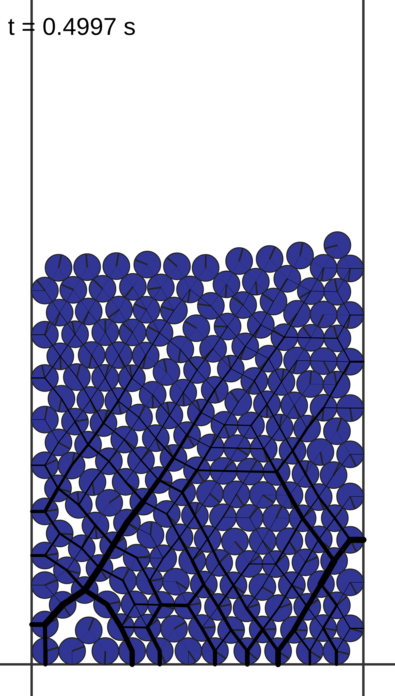 |


> **Exercice 6.2** — Faire varier $D_{Verlet}$ de $10^{-5}$ à $10^{-3}$ m et relever le nombre de reconstructions et le temps de calcul. Pourquoi y a-t-il un optimum ?

> **Exercice 6.3** — Prendre $D_{Verlet} = 0$. Que se passe-t-il ? Pourquoi ?

---

## Étape 7 — Grille de cellules liées

> **Objectif** : construire la liste de Verlet en $O(N)$ au moyen d'une grille de cellules, et l'appliquer au dépôt de 1500 disques.
> **Point de départ** : votre fichier de l'étape 6.
> **Corrigé** : `corriges/etape7_cellules.cpp`

### 7.1 Grille de cellules (*link cells*)

La liste de Verlet de l'étape 6 n'est reconstruite qu'occasionnellement, mais chaque reconstruction teste encore toutes les paires, en $O(N^2)$. Pour la construire en $O(N)$, les particules sont réparties dans une grille de cellules carrées dont le côté est supérieur à la taille de la plus grande OBB élargie. Deux OBB en intersection se trouvent alors nécessairement dans la même cellule ou dans deux cellules adjacentes : pour chaque particule, il suffit d'examiner les 9 cellules qui l'entourent.

Taille des cellules : une OBB élargie d'un disque de rayon $r$ est un carré de demi-côté $r + D_{Verlet}/2$, qui peut être tourné. Sa demi-diagonale vaut $\sqrt 2\,(r + D_{Verlet}/2)$. Deux boîtes qui se touchent ont donc des centres distants d'au plus $2\sqrt 2\,(r_{max} + D_{Verlet}/2)$.

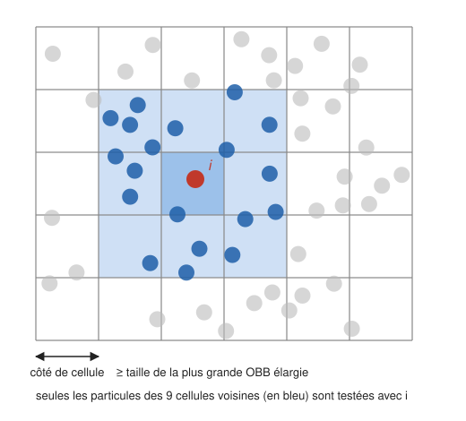

```cpp
void build_verlet_list_cells(const System& sys, std::vector<Interaction>& list) {
  const auto& P = sys.particles;
  const int n = (int)P.size();
  if (n == 0) return;

  // OBB élargies, plus grand rayon et boîte [lo, hi] contenant tous les centres
  std::vector<OBB> obb(n);
  double rmax = 0.0;
  Vec2 lo = P[0].pos, hi = P[0].pos;
  for (int i = 0; i < n; ++i) {
    obb[i] = particle_obb(P[i]);
    enlarge(obb[i], 0.5 * sys.prm.DVerlet);
    rmax = std::max(rmax, P[i].radius);
    lo = {std::min(lo.x, P[i].pos.x), std::min(lo.y, P[i].pos.y)};
    hi = {std::max(hi.x, P[i].pos.x), std::max(hi.y, P[i].pos.y)};
  }

  // Taille et nombre de cellules
  const double cell_size = 2.0 * std::sqrt(2.0) * (rmax + 0.5 * sys.prm.DVerlet);
  const int nx = (int)((hi.x - lo.x) / cell_size) + 1;
  const int ny = (int)((hi.y - lo.y) / cell_size) + 1;

  // Rangement des particules dans les cellules
  std::vector<std::vector<int>> cells(nx * ny);
  std::vector<int> cx(n), cy(n);
  for (int i = 0; i < n; ++i) {
    cx[i] = (int)((P[i].pos.x - lo.x) / cell_size);
    cy[i] = (int)((P[i].pos.y - lo.y) / cell_size);
    cells[cy[i] * nx + cx[i]].push_back(i);
  }

  // Pour chaque particule, on ne teste que les 9 cellules autour d'elle
  for (int i = 0; i < n; ++i) {
    for (int ky = cy[i] - 1; ky <= cy[i] + 1; ++ky)
      for (int kx = cx[i] - 1; kx <= cx[i] + 1; ++kx) {
        if (kx < 0 || ky < 0 || kx >= nx || ky >= ny) continue;
        for (int j : cells[ky * nx + kx])
          if (j > i && intersect(obb[i], obb[j])) list.push_back(new_interaction(i, j, false));
      }
    for (int w = 0; w < (int)sys.walls.size(); ++w)  // les parois, comme avant
      if (intersect(obb[i], sys.walls[w])) list.push_back(new_interaction(i, w, true));
  }
}
```

`std::min` et `std::max` nécessitent `#include <algorithm>`. Dans `update_interactions`, l'appel à `build_verlet_list_brute_force` est remplacé par `build_verlet_list_cells` ; le reste de la fonction est inchangé.

Le test `j > i` évite de traiter deux fois la même paire. C'est la méthode `UpdateNL_linkCells` de Rockable. exaDEM utilise une grille du même type, qui sert aussi à découper le domaine entre les processeurs.

### 7.2 Mise en œuvre : dépôt de 1500 disques

On part du fichier de l'étape 6, dans lequel `update_interactions` appelle maintenant `build_verlet_list_cells`. Seule la mise en données change : on place 1500 disques de rayons tirés aléatoirement entre 1,5 et 2,5 mm sur un réseau, au-dessus d'une boîte de 16 cm de large, avec une faible vitesse initiale aléatoire.

| Paramètre | Valeur |
|---|---|
| boîte | sol $y = 0$, murs $x = 0$ et $x = 0{,}16$ m |
| disques | 1500, rayons uniformément répartis entre 1,5 et 2,5 mm |
| masse volumique $\rho$ | 2500 kg/m³ |
| raideurs | $k_n = 10^6$, $k_t = 0{,}8\,k_n$ |
| frottement, restitution | $\mu = 0{,}5$, $e = 0{,}5$ |
| pas de temps | $\Delta t = t_c/30$, calculé sur le plus petit disque |
| distance de Verlet | $D_{Verlet} = 0{,}2\,r_{min}$ |
| durée simulée | 0,8 s, une image toutes les 0,01 s |

**1. Les paramètres globaux** se réduisent à :

```cpp
// ===================== PARAMÈTRES ====================================
const double rho = 2500.0;   // masse volumique (kg/m^3)
const double re = 0.5;       // coefficient de restitution visé
const int n_disks = 1500;    // nombre de disques
const double t_end = 0.8;    // durée simulée (s)
const double t_save = 0.01;  // une image tous les t_save secondes
```

**2. Une fonction `setup_deposit`** crée la boîte et les disques et fixe tous les paramètres du modèle. Elle se place après `critical_time`, qu'elle utilise.

La génération des disques utilise `<random>` (à inclure en tête de fichier). Le générateur `std::mt19937` reçoit une **graine fixe** : la suite de nombres tirés est toujours la même, donc la simulation est reproductible d'une exécution à l'autre. Les disques sont posés sur un réseau carré de pas $2{,}2\,r_{max}$, ce qui garantit qu'aucun disque ne chevauche son voisin au départ ; `k % ncols` donne la colonne et `k / ncols` la ligne. Une petite vitesse aléatoire (±0,1 m/s) casse la symétrie du réseau, sans quoi les disques tomberaient en colonnes parfaitement alignées.

```cpp
#include <random>

void setup_deposit(System& sys, int n) {
  const double rmin = 1.5e-3, rmax = 2.5e-3;  // rayons extrêmes (m)
  const double width = 0.16;
  // sol, paroi gauche, paroi droite
  sys.walls = {
      {{0.0, 0.0}, {0.0, 1.0}}, {{0.0, 0.0}, {1.0, 0.0}}, {{width, 0.0}, {-1.0, 0.0}}};

  std::mt19937 gen(12345);  // graine fixe : simulation reproductible
  std::uniform_real_distribution<double> radius(rmin, rmax), noise(-0.1, 0.1);
  const double spacing = 2.2 * rmax;
  const int ncols = static_cast<int>((width - 2.0 * rmax) / spacing);
  for (int k = 0; k < n; ++k) {
    const Vec2 pos{rmax + spacing * (0.5 + k % ncols),
                   rmax + spacing * (0.5 + k / ncols)};
    sys.particles.push_back(make_disk(pos, {noise(gen), noise(gen)}, radius(gen), rho));
  }

  sys.prm.kn = 1.0e6;
  sys.prm.kt = 0.8e6;
  sys.prm.mu = 0.5;
  sys.prm.damp_rate = damping_ratio_from_restitution(re);
  const double mmin = rho * M_PI * rmin * rmin;  // le plus petit disque fixe le pas de temps
  sys.prm.dt = critical_time(0.5 * mmin, sys.prm.kn) / 30.0;
  sys.prm.DVerlet = 0.2 * rmin;
}
```

Avec 16 cm de large, on obtient 28 disques par ligne, donc environ 54 lignes pour 1500 disques : la colonne initiale monte à près de 30 cm. Le pas de temps est calculé sur le **plus petit** disque (masse effective $m_{min}/2$ pour deux petits disques en contact), car c'est lui qui impose le temps de contact le plus court.

> **Attention** — `setup_deposit` définit déjà les parois et le pas de temps. Le `main` ne doit donc plus ajouter les parois de l'étape 6, ni recalculer `sys.prm.dt` à partir de `sys.particles[0]` (le premier disque n'est pas le plus petit).

**3. Le `main`** est celui de l'étape 6, dont le début se simplifie :

```cpp
int main() {
  System sys;
  setup_deposit(sys, n_disks);  // la boîte, les disques et tous les paramètres

  const int nsteps = static_cast<int>(t_end / sys.prm.dt);
  const int n_save = static_cast<int>(t_save / sys.prm.dt);  // pas entre deux images
  const int n_print = nsteps / 10;                            // pas entre deux bilans

  viz::Recorder rec("sortie_etape7");
  update_interactions(sys, true);
  compute_forces(sys);
  rec.save(make_scene(sys, 0.0));  // état initial
  // ... boucle en temps de l'étape 6, inchangée ...
}
```

### 7.3 Résultats attendus

```
# t (s)   Ec (J/m)    Ep (J/m)
0.080 1.1555e+01 5.7343e+01
0.160 9.7381e+00 3.5743e+01
0.240 5.3144e-02 3.4825e+01
...
0.800 4.2501e-06 3.4753e+01
1882 reconstructions de la liste pour 127661 pas
81 images : ouvrir sortie_etape7/viewer.html
```

Pour mesurer le gain apporté par la grille, on compare les temps de calcul (`time ./etape7`) en remplaçant, dans `update_interactions`, l'appel à `build_verlet_list_cells` par `build_verlet_list_brute_force` :

| Construction de la liste de Verlet | Temps de calcul |
|---|---|
| force brute, $O(N^2)$ (étape 6) | 28 s |
| grille de cellules, $O(N)$ | 16 s |

Les temps dépendent de la machine ; seul leur rapport est significatif. Le gain est limité ici, car la liste n'est reconstruite qu'une fois tous les 70 pas environ : l'essentiel du temps est passé dans le calcul des forces. Il croît avec $N$, puisque le coût de la force brute croît comme $N^2$ alors que celui de la grille croît comme $N$.

| Pendant la chute | Après le dépôt |
|:---:|:---:|
| 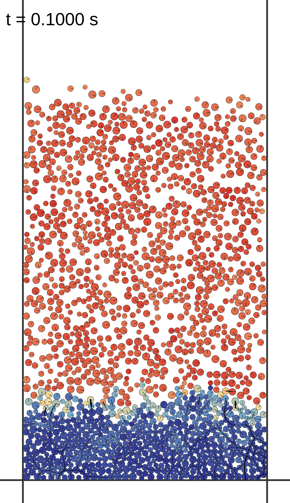 | 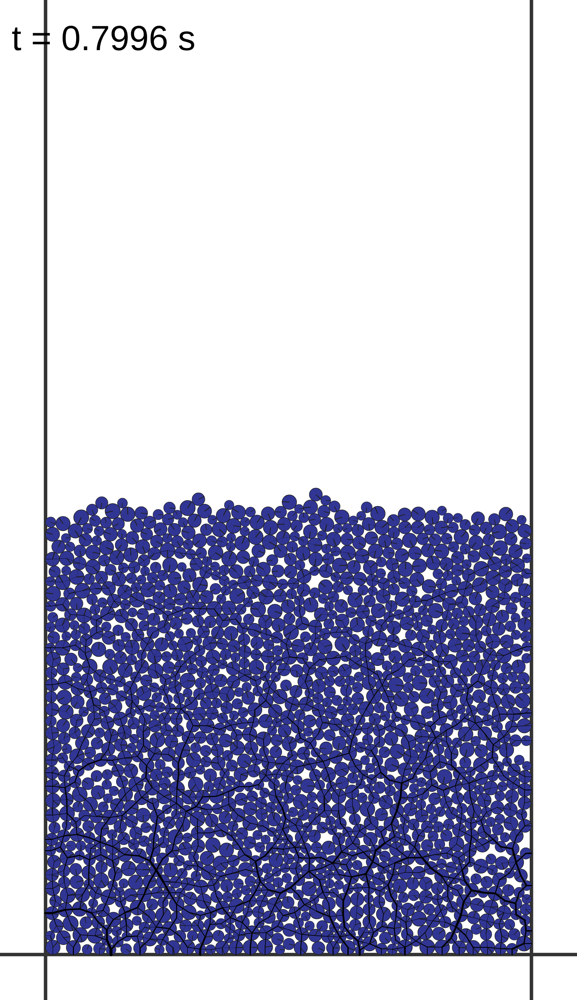 |

> **Exercice 7.1** — Doubler $k_n$. Que deviennent le pas de temps et le temps de calcul ? Mesurer l'interpénétration maximale dans l'état final, avant et après.

> **Exercice 7.2** — Dans `transfer_history`, supprimer la recopie de `ft`. L'empilement reste-t-il stable ? Examiner l'énergie cinétique en fin de dépôt.

> **Exercice 7.3** — Dans l'état final, calculer le **nombre de coordination** $z$ (nombre moyen de contacts par grain, soit $2 N_c / N$ avec $N_c$ le nombre d'interactions disque-disque où `fn > 0`) et la **compacité** (fraction de surface occupée par les grains, mesurée dans une bande horizontale loin du fond et de la surface). Des valeurs proches de $z \approx 3{,}4$ et d'une compacité de 0,8 sont typiques d'un empilement 2D désordonné de disques frottants.


---

## Étape 8 — Organisation du code et application : effondrement d'une colonne

> **Objectif** : séparer le moteur DEM de l'application, puis simuler une expérience classique de la physique des milieux granulaires.
> **Corrigés** : `corriges/dem2d.hpp` et `corriges/etape8_effondrement.cpp`

### 8.1 Regroupement du moteur dans un fichier d'en-tête

Le code écrit aux étapes 1 à 7 (structures, loi de contact, voisins, pas de temps) ne dépend pas de l'expérience simulée. Seules la mise en données (`make_scene`, `setup_deposit`…) et la fonction `main` changent d'une simulation à l'autre. On sépare donc :

- le **moteur**, placé dans un fichier d'en-tête `dem2d.hpp`, écrit une fois pour toutes ;
- l'**application**, un fichier `.cpp` court qui inclut `dem2d.hpp`, décrit la simulation et l'exécute.

C'est l'organisation retenue par exaDEM et Rockable : un moteur de calcul, et des fichiers d'entrée qui décrivent chaque simulation.

#### 8.1.1 Rappel : que fait `#include` ?

La directive `#include "fichier.hpp"` est traitée par le **préprocesseur**, avant la compilation proprement dite : elle est remplacée par le contenu intégral du fichier, comme un copier-coller. Le compilateur ne voit ensuite qu'un seul long fichier.

Un en-tête peut donc se retrouver inclus **deux fois** dans le même fichier `.cpp`, souvent sans que ce soit visible, par exemple :

```cpp
// application.cpp
#include "dem2d.hpp"
#include "post_traitement.hpp"   // qui contient lui-même #include "dem2d.hpp"
```

Après le copier-coller, `struct Vec2`, `struct Particle`, etc. apparaissent deux fois, et le compilateur s'arrête :

```
error: redefinition of 'struct Vec2'
```

#### 8.1.2 La directive `#pragma once`

`#pragma once`, placée en **première ligne** d'un en-tête, demande au préprocesseur de n'inclure ce fichier qu'**une seule fois** par fichier `.cpp`, quel que soit le nombre de `#include` qui y mènent. Les inclusions suivantes sont ignorées et l'erreur de redéfinition disparaît.

On rencontre aussi l'écriture équivalente, plus ancienne et seule garantie par la norme C++, dite des *include guards* :

```cpp
#ifndef DEM2D_HPP
#define DEM2D_HPP
// ... contenu de l'en-tête ...
#endif
```

Au premier passage, la macro `DEM2D_HPP` n'est pas définie : le contenu est lu et la macro est définie. Aux passages suivants, le `#ifndef` est faux et tout le contenu est sauté. `#pragma once` fait la même chose en une ligne. Bien que non normalisé, il est reconnu par tous les compilateurs courants (GCC, Clang, MSVC, Intel) ; c'est la forme utilisée dans ce tutoriel.

#### 8.1.3 Le mot-clé `inline`

`#pragma once` protège contre la double inclusion **dans un même** fichier `.cpp`. Il reste un second problème lorsque le projet comporte **plusieurs** fichiers `.cpp` qui incluent chacun `dem2d.hpp` : chaque fichier compilé contient alors sa propre copie de `dot`, `contact_force`, etc. À l'édition de liens, le linker trouve plusieurs définitions de la même fonction :

```
multiple definition of `dot(Vec2, Vec2)'
```

Le mot-clé `inline` placé devant une fonction indique que des définitions identiques peuvent apparaître dans plusieurs fichiers compilés ; le linker n'en garde qu'une. **Toute fonction définie dans un en-tête doit donc être précédée de `inline`.** Les `struct` n'en ont pas besoin (une définition de type peut figurer dans plusieurs fichiers compilés).

Pour résumer :

| Problème | Situation | Solution |
|---|---|---|
| `redefinition of 'struct Vec2'` (compilateur) | l'en-tête est inclus deux fois dans le même `.cpp` | `#pragma once` |
| `multiple definition of 'dot'` (linker) | l'en-tête est inclus dans deux `.cpp` différents | `inline` devant chaque fonction |

Avec un seul fichier `.cpp`, comme ici, aucune de ces erreurs ne se produit encore ; on prend néanmoins ces deux précautions dès le départ, car l'en-tête sera réutilisé par d'autres programmes.

#### 8.1.4 Construction de `dem2d.hpp` pas à pas

On part du fichier de l'étape 7, qui contient déjà tout le moteur.

**1. Créer le fichier et son en-tête.** Le fichier commence par `#pragma once`, suivi des `#include` de la bibliothèque standard utilisés par le moteur et de la bibliothèque de visualisation :

```cpp
// dem2d.hpp : le moteur DEM 2D construit aux étapes 1 à 7
#pragma once

#include <algorithm>
#include <cmath>
#include <cstdio>
#include <map>
#include <tuple>
#include <vector>

#include "./../viz/dem_viz.hpp"
```

Un en-tête doit inclure lui-même tout ce dont il a besoin : l'application ne doit pas avoir à deviner qu'il faut inclure `<map>` avant `dem2d.hpp`.

**2. Recopier le moteur, dans l'ordre des dépendances.** Une fonction ne peut être utilisée qu'après avoir été déclarée ; on recopie donc les blocs du fichier de l'étape 7 dans cet ordre :

| Bloc | Contenu | Étape d'origine |
|---|---|---|
| Vecteurs | `Vec2`, opérateurs, `dot`, `norm`, `cross` | 1, 3, 5 |
| Données | `Particle`, `Wall`, `Interaction`, `Params`, `System` | 1 à 7 |
| Loi de contact | `damping_ratio_from_restitution`, `contact_force`, `particle_particle`, `particle_wall` | 2 à 5 |
| Boîtes englobantes | `OBB`, `particle_obb`, `enlarge`, `projected_radius`, `intersect` | 6 |
| Liste d'interactions | `new_interaction`, `transfer_history`, `need_update`, `build_verlet_list_brute_force`, `build_verlet_list_cells`, `update_interactions` | 5 à 7 |
| Boucle DEM | `compute_forces`, `exec_one_iter` | 3 à 5 |
| Utilitaires | `make_disk`, `critical_time`, `kinetic_energy`, `total_momentum`, `potential_energy`, `make_scene` | 3 à 5 |

La résistance au roulement (section 5.5) est ajoutée à la section 8.2 si elle ne l'a pas été à l'étape 5.

`kinetic_energy` est complétée par l'énergie de rotation $\tfrac12 I\omega^2$ ; elle servira à détecter le repos de la colonne :

```cpp
inline double kinetic_energy(const System& sys) {
  double ek = 0.0;
  for (const auto& p : sys.particles)
    ek += 0.5 * p.mass * dot(p.vel, p.vel) + 0.5 * p.inertia * p.omega * p.omega;
  return ek;
}
```

Deux fonctions sont à vérifier en recopiant :

- `update_interactions` doit appeler `build_verlet_list_cells` (étape 7), et non plus `build_verlet_list_brute_force` ;
- `exec_one_iter` fait désormais avancer le temps physique du système, ce qui permet d'écrire les boucles sous la forme `while (sys.time < t_end)` :

```cpp
inline void exec_one_iter(System& sys) {
  // ... inchangé ...
  sys.time += dt;  // le système connaît son temps physique
}
```

**3. Ajouter `inline` devant chaque fonction**, opérateurs compris :

```cpp
inline Vec2 operator+(Vec2 a, Vec2 b) { return {a.x + b.x, a.y + b.y}; }
inline double dot(Vec2 a, Vec2 b) { return a.x * b.x + a.y * b.y; }
inline void compute_forces(System& sys) { /* inchangé */ }
```

**4. Ne pas recopier** ce qui est propre à une simulation : la fonction `main`, la mise en données (`setup_deposit`), les mesures de temps de calcul. Ces éléments restent dans le fichier de l'application.

**5. Écrire l'application.** Le fichier `etape8_effondrement.cpp` se réduit à :

```cpp
#include <cstdlib>
#include <random>

#include "dem2d.hpp"

int main(int argc, char** argv) {
  System sys;
  // 1. renseigner sys.prm, sys.walls, sys.particles
  // 2. initialiser la liste et les forces
  update_interactions(sys, true);
  compute_forces(sys);
  // 3. avancer en temps
  while (sys.time < t_end) exec_one_iter(sys);
  return 0;
}
```

**6. Compiler.** Seul le fichier `.cpp` est donné au compilateur ; l'en-tête est lu au travers du `#include` :

```bash
g++ -O2 -std=c++17 etape8_effondrement.cpp -o etape8
```

Si `dem2d.hpp` se trouve dans un autre répertoire, on l'indique avec l'option `-I` (par exemple `-I../corriges`).

Le chemin `"./../viz/dem_viz.hpp"` écrit dans `dem2d.hpp` est interprété **relativement au répertoire de `dem2d.hpp`**, et non à celui du fichier compilé.

**Points de vigilance.**

- Sous Linux et macOS, les noms de fichiers distinguent majuscules et minuscules : `#include "dem2d.hpp"` ne trouve pas un fichier nommé `DEM2D.hpp`.
- Un `inline` oublié ne provoque aucune erreur tant que l'en-tête n'est inclus que dans un seul `.cpp` : l'oubli passe inaperçu jusqu'au jour où le moteur est utilisé par deux fichiers.
- `std::cout` nécessite `#include <iostream>`. Le moteur n'utilise que `std::printf` (`<cstdio>`).

> **Exercice 8.1** — Vérifier le rôle de `#pragma once` : inclure deux fois `dem2d.hpp` dans un petit programme, compiler, puis commenter la ligne `#pragma once` et recompiler. Lire le message d'erreur obtenu. Faire de même avec `inline` : créer un second fichier `outils.cpp` qui inclut `dem2d.hpp`, compiler les deux fichiers ensemble (`g++ etape8_effondrement.cpp outils.cpp`), retirer `inline` devant `dot`, et observer l'erreur du linker.

### 8.2 Résistance au roulement

Pour l'effondrement, la résistance au roulement de la section 5.5 devient **indispensable** : sans elle, quelques disques roulent indéfiniment sur le sol plat, l'énergie cinétique ne tend jamais vers zéro et le critère d'arrêt de la simulation n'est jamais atteint.

Si elle n'a pas été ajoutée à l'étape 5, recopier dans `dem2d.hpp` les extraits 1 à 4 de la section 5.5 (en ajoutant `inline` devant `rolling_moment`). Les valeurs des paramètres sont données dans le programme de la section 8.3.

### 8.3 Effondrement d'une colonne granulaire

Une colonne de largeur $L_0$ et de hauteur $H_0$ est remplie de grains, puis fermée par une paroi amovible (la « porte »). Le retrait brusque de la porte provoque l'effondrement et l'étalement de la colonne. On mesure l'étalement final $L$ et la hauteur finale $H$ en fonction du rapport d'aspect $a = H_0/L_0$.

Cette configuration a été largement étudiée, en laboratoire et en DEM, notamment par Lajeunesse, Mangeney-Castelnau et Vilotte (2004), Lube et al. (2005) et Staron et Hinch (2005).

Le programme `etape8_effondrement.cpp` ne contient que la mise en données, la boucle en temps et les mesures ; tout le reste est dans `dem2d.hpp`. Il se construit en six étapes.

| Paramètre | Valeur |
|---|---|
| colonne | largeur $L_0 = 6$ cm, hauteur visée $H_0 = a\,L_0$ ($a = 2$ par défaut) |
| parois | sol $y = 0$, mur gauche $x = 0$, porte $x = L_0$ |
| disques | rayons uniformément répartis entre 1,5 et 2,5 mm, $\rho = 2500$ kg/m³ |
| contact | $k_n = 10^6$, $k_t = 0{,}8\,k_n$, $\mu = 0{,}5$, $e = 0{,}5$ |
| roulement | $\mu_r = 0{,}1\,\bar r$, $k_r = 0{,}25\,k_n\,r_{min}^2$ |
| pas de temps | $\Delta t = t_c/30$, calculé sur le plus petit disque |
| distance de Verlet | $D_{Verlet} = 0{,}2\,r_{min}$ |
| sorties | une image toutes les 0,01 s après l'ouverture de la porte |

#### 8.3.1 En-tête et paramètres

```cpp
#include <algorithm>  // std::max, std::sort
#include <cstdlib>    // std::atof
#include <random>

#include "dem2d.hpp"

// ===================== PARAMÈTRES ====================================
const double rho = 2500.0;                  // masse volumique (kg/m^3)
const double re = 0.5;                      // coefficient de restitution visé
const double rmin = 1.5e-3, rmax = 2.5e-3;  // rayons extrêmes des disques (m)
const double L0 = 0.06;                     // largeur de la colonne (m)
const double dt_factor = 30.0;              // nombre de pas de temps par contact
const double t_save = 0.01;                 // une image tous les t_save secondes
const double t_max = 3.0;                   // durée maximale de l'effondrement (s)
```

#### 8.3.2 Création de la colonne

La fonction `setup_column` reprend le principe de `setup_deposit` (étape 7) : disques de rayons aléatoires posés sur un réseau, avec une petite vitesse aléatoire. Deux différences :

- la largeur de la boîte est $L_0$, et le nombre de disques `n` est passé en argument ;
- la paroi de droite est la **porte**. Elle est ajoutée **en dernier**, pour pouvoir être retirée simplement par `sys.walls.pop_back()`.

```cpp
// Remplit la colonne de n disques de rayons aléatoires, sur un réseau
void setup_column(System& sys, int n) {
  // sol, mur gauche, et la porte (en dernier, pour pouvoir la retirer)
  sys.walls.push_back({{0.0, 0.0}, {0.0, 1.0}});  // 0 : sol
  sys.walls.push_back({{0.0, 0.0}, {1.0, 0.0}});  // 1 : mur gauche
  sys.walls.push_back({{L0, 0.0}, {-1.0, 0.0}});  // 2 : la porte

  std::mt19937 gen(2024);  // graine fixe : simulation reproductible
  std::uniform_real_distribution<double> radius(rmin, rmax), noise(-0.05, 0.05);
  const double spacing = 2.2 * rmax;
  const int ncols = static_cast<int>((L0 - 2.0 * rmax) / spacing);
  for (int k = 0; k < n; ++k) {
    const Vec2 pos{rmax + spacing * (0.5 + k % ncols),
                   rmax + spacing * (0.5 + k / ncols)};
    sys.particles.push_back(make_disk(pos, {noise(gen), noise(gen)}, radius(gen), rho));
  }
}
```

Avec $L_0 = 6$ cm, on obtient 10 disques par ligne.

#### 8.3.3 Matériau et nombre de disques

Le `main` lit le rapport d'aspect sur la ligne de commande (`./etape8 4`), avec $a = 2$ par défaut, puis renseigne les paramètres du modèle :

```cpp
int main(int argc, char** argv) {
  const double aspect = (argc > 1) ? std::atof(argv[1]) : 2.0;  // a = H0 / L0

  System sys;
  sys.prm.kn = 1.0e6;
  sys.prm.kt = 0.8e6;
  sys.prm.mu = 0.5;
  sys.prm.damp_rate = damping_ratio_from_restitution(re);
  sys.prm.mur = 0.1 * 0.5 * (rmin + rmax);       // résistance au roulement
  sys.prm.kr = 0.25 * sys.prm.kn * rmin * rmin;
  const double mmin = rho * M_PI * rmin * rmin;  // le plus petit disque
  sys.prm.dt = critical_time(0.5 * mmin, sys.prm.kn) / dt_factor;
  sys.prm.DVerlet = 0.2 * rmin;
```

Le nombre de disques est choisi pour que la colonne, une fois tassée, atteigne la hauteur $H_0 = a\,L_0$. La surface de la colonne est $L_0 H_0$ ; avec une compacité d'environ 0,8 (étape 7), les grains en occupent $0{,}8\,L_0 H_0$. En divisant par la surface d'un disque moyen, $\pi \bar r^2$, on obtient le nombre de disques. Le facteur 1,04 est une petite correction qui tient compte de la dispersion des rayons (pour des rayons uniformes entre 1,5 et 2,5 mm, $\overline{r^2} \approx 1{,}02\,\bar r^2$) et du tassement imparfait le long des parois ; la hauteur obtenue est ensuite mesurée :

$$
n = \frac{0{,}8\,L_0\,H_0}{1{,}04\,\pi\,\bar r^2}
$$

```cpp
  const double rmean = 0.5 * (rmin + rmax);
  const int n = static_cast<int>(0.8 * L0 * aspect * L0 / (M_PI * rmean * rmean * 1.04));
  setup_column(sys, n);
  std::printf("a = %.2f, %d disques, dt = %.2e s\n", aspect, n, sys.prm.dt);
```

#### 8.3.4 Phase 1 : remplissage jusqu'au repos

Les disques tombent dans la colonne fermée. On avance jusqu'à ce que l'empilement soit au repos : le critère combine une durée minimale (0,3 s, le temps que les grains tombent) et un seuil sur l'énergie cinétique. On mesure ensuite la hauteur réelle $H_0$ de la colonne.

```cpp
  update_interactions(sys, true);
  compute_forces(sys);
  while (sys.time < 0.3 || kinetic_energy(sys) > 1e-6) exec_one_iter(sys);

  double H0 = 0.0;
  for (const auto& p : sys.particles) H0 = std::max(H0, p.pos.y + p.radius);
  std::printf("colonne au repos à t = %.2f s : H0 = %.4f m, L0 = %.4f m, H0/L0 = %.2f\n",
              sys.time, H0, L0, H0 / L0);
```

#### 8.3.5 Phase 2 : ouverture de la porte

On retire la porte, puis on **impose** la reconstruction de la liste : elle contient des interactions avec la paroi d'indice 2, qui n'existe plus, et `need_update` ne peut pas le détecter puisque aucun grain n'a bougé. Le temps est remis à zéro pour compter depuis l'ouverture.

```cpp
  sys.walls.pop_back();            // la porte était la dernière paroi
  update_interactions(sys, true);  // la liste contenait des contacts avec la porte
  compute_forces(sys);
  sys.time = 0.0;                  // on compte le temps depuis l'ouverture
```

La boucle en temps enregistre une image toutes les `t_save` secondes et s'arrête lorsque l'écoulement est terminé. La fenêtre de l'animation est fixée une fois pour toutes, de façon à contenir le tas étalé ; sans cela, elle serait calculée sur la première image, c'est-à-dire sur la colonne seule :

```cpp
  viz::Recorder rec("sortie_etape8");
  const double view_width = L0 * (1.0 + 4.0 * aspect);  // fenêtre fixe pour l'animation
  double next_save = 0.0;
  while (sys.time < t_max) {
    if (sys.time >= next_save) {
      viz::Scene scene = make_scene(sys, sys.time);
      scene.xmin = -0.05 * view_width;
      scene.xmax = 1.05 * view_width;
      scene.ymin = -0.05 * H0;
      scene.ymax = 1.1 * H0;
      rec.save(scene);
      next_save += t_save;
    }
    exec_one_iter(sys);
    if (sys.time > 0.2 && kinetic_energy(sys) < 1e-7) break;  // écoulement arrêté
  }
```

#### 8.3.6 Mesures

La hauteur finale $H$ est la cote du point le plus haut. L'étalement $L$ est mesuré au **front** du tas : quelques grains isolés roulent toujours loin du tas, et le grain le plus éloigné ne représente pas l'étalement. On trie les abscisses et on prend celle en dessous de laquelle se trouvent 99,5 % des grains :

```cpp
  std::vector<double> xs;
  double H = 0.0;
  for (const auto& p : sys.particles) {
    xs.push_back(p.pos.x + p.radius);
    H = std::max(H, p.pos.y + p.radius);
  }
  std::sort(xs.begin(), xs.end());
  const double L = xs[static_cast<size_t>(0.995 * (xs.size() - 1))];
  std::printf("arrêt à t = %.2f s après l'ouverture (%d images)\n", sys.time, rec.frames());
  std::printf("étalement final L = %.4f m, hauteur finale H = %.4f m\n", L, H);
  std::printf("(L - L0) / L0 = %.2f, H / L0 = %.2f\n", (L - L0) / L0, H / L0);
  std::printf("%d reconstructions de la liste\n", sys.nb_rebuilds);
  std::printf("images : ouvrir sortie_etape8/viewer.html\n");
  return 0;
}
```

### 8.4 Résultats attendus

```
a = 2.00, 440 disques, dt = 6.27e-06 s
colonne au repos à t = 0.35 s : H0 = 0.1245 m, L0 = 0.0600 m, H0/L0 = 2.07
arrêt à t = 1.59 s après l'ouverture (160 images)
étalement final L = 0.3261 m, hauteur finale H = 0.0600 m
(L - L0) / L0 = 4.43, H / L0 = 1.00
6382 reconstructions de la liste
images : ouvrir sortie_etape8/viewer.html
```

Le calcul dure une dizaine de secondes.

| Avant l'ouverture | Pendant l'effondrement | État final |
|:---:|:---:|:---:|
| 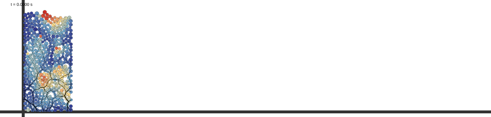 | 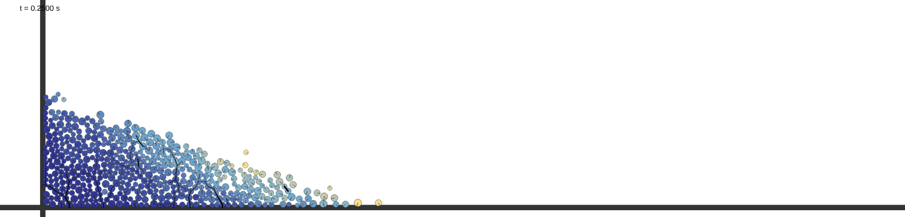 | 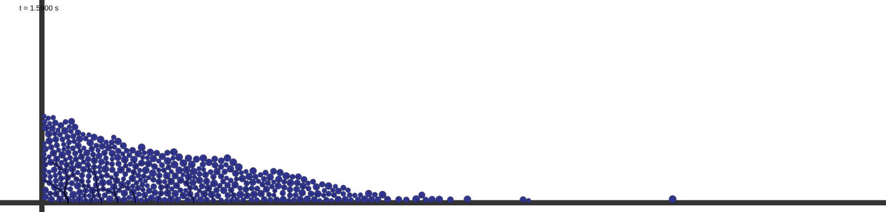 |

Le programme accepte le rapport d'aspect en argument : `./etape8 4`.

> **Exercice 8.2** — Tracer $(L - L_0)/L_0$ et $H/L_0$ en fonction de $a$, pour $a$ compris entre 0,5 et 6. Les expériences 2D de Lube et al. (2005) montrent un régime linéaire aux petits $a$ et une loi de puissance d'exposant proche de 2/3 aux grands $a$. Ces deux régimes sont-ils retrouvés ?
> **Exercice 8.3** — Le sol est ici une paroi lisse, alors que les expériences sont souvent réalisées sur un fond rugueux, qui réduit l'étalement. Rendre le fond rugueux au moyen d'une rangée de grains immobiles (champ `bool fixed` ajouté à `Particle`, ces grains n'étant pas déplacés dans `exec_one_iter`), puis comparer.
> **Exercice 8.4** — Étudier l'effet de $\mu$ et de $\mu_r$ sur l'étalement.

---

## Annexe A — Correspondance avec exaDEM et Rockable

| Ce tutoriel | exaDEM | Rockable |
|---|---|---|
| `Particle` (`pos`, `vel`, `force`, `omega`, `torque`) | champs de la grille de particules (`rx`, `vx`, `fx`, `vrot`, `mom`…) | `Particle` (`pos`, `vel`, `force`, `vrot`, `moment`, `Q`) |
| $\delta_n > 0$ en contact | `dn < 0` en contact | `I.dn < 0` en contact |
| `damp_rate` ($\zeta$) | `damp_rate` dans `ContactParams` | calculé à partir de `en2` ($e^2$) |
| `contact_force` | `hooke_contact_force_core` (`contact_force_hooke.hpp`) | `ForceLaw_Default::computeInteraction` |
| seuil $\mu\,k_n\,\delta_n$ | `compute_threshold_ft` | `threshold = fabs(mu * fne)` |
| `rolling_moment` (`kr`, `mur`) | `update_rolling_moment` (`kr`) | `kr`, `mur` |
| `Interaction` (`ft`, `mom`, `fn`) | interactions avec `friction` et `moment` | `Interaction` (`ft`, `mom`, `fn`, `dn`) |
| `transfer_history` | mise à jour des interactions entre deux reconstructions | `AddOrRemoveInteractions` + `Interactions_from_set_to_vec` |
| `OBB`, `enlarge`, `intersect` | `OBB.hpp`, `OBBtree.hpp` | `OBB`, `obb.enlarge(0.5 * DVerlet)`, `obbi.intersect(obbj)` |
| `DVerlet` | `rcut_inc` / `rVerlet` | `DVerlet` (grains) et `dVerlet` (sous-éléments) |
| `need_update` (déplacement > `DVerlet/2`) | `particle_displ_over`, `vertex_displ_over` | `interVerlet`, `dynamicUpdateNL` |
| `build_verlet_list_brute_force` | — | `UpdateNL_bruteForce` |
| `build_verlet_list_cells` | grille de cellules (et découpage MPI) | `UpdateNL_linkCells` |
| `exec_one_iter` (velocity Verlet) | `combined_compute_prolog` / `combined_compute_epilog` (les deux demi-pas) | `velocityVerletStep` |

Fonctionnalités des deux codes non traitées dans ce tutoriel : la 3D et les quaternions, les formes non sphériques (polyèdres, sphéro-polyèdres), le contact multiple entre sous-éléments (sommets, arêtes, faces), les lois cohésives, la parallélisation (OpenMP, MPI, GPU), les conditions aux limites périodiques et les parois pilotées.

## Annexe B — Visualisation des résultats

Pour chaque appel à `rec.save(scene)`, la librairie `viz/dem_viz.hpp` écrit dans le dossier de sortie :

| Fichier | Contenu | Comment l'ouvrir |
|---|---|---|
| `viewer.html` | animation de toutes les images | dans un navigateur, bouton « Lecture » |
| `frame_XXXXX.svg` | une image | dans un navigateur |
| `particles_XXXXX.vtk`, `particles.pvd` | disques (rayon, angle, vitesse) | ParaView |
| `contacts_XXXXX.vtk`, `contacts.pvd` | réseau des forces normales | ParaView |

**Dans ParaView** :

1. *File → Open* `particles.pvd`, puis *Apply* ;
2. filtre *Glyph* : *Glyph Type* = *2D Glyph* puis *Circle* (ou *Sphere*), *Scale Array* = `radius`, *Scale Factor* = 2 (le glyphe a un diamètre unité) ;
3. colorer par `velocity` ;
4. ouvrir également `contacts.pvd`, appliquer un filtre *Tube* et colorer par `fn` pour visualiser les chaînes de forces.

Dans les images SVG, la couleur des disques représente la norme de la vitesse (bleu : faible, rouge : élevée ; l'échelle correspond à la plus grande vitesse rencontrée depuis le début de l'enregistrement). Le trait tracé dans chaque disque indique sa rotation, et l'épaisseur des segments noirs entre les centres est proportionnelle à la force normale.

## Annexe C — Prolongements

- **Loi de Hertz** : remplacer $k_n\,\delta_n$ par une raideur qui dépend de $\delta_n$ (exaDEM en propose une, `contact_force_hertz.hpp`).
- **Cohésion** : autoriser une force normale négative jusqu'à un seuil (`fc`, `dncut` dans exaDEM).
- **Parois mobiles** : donner une vitesse aux parois, pour un cisaillement ou une compression.
- **Conditions périodiques** : supprimer les murs latéraux et recoller le domaine sur lui-même.
- **Parallélisation** : la boucle de `compute_forces` sur les interactions se parallélise avec OpenMP, à condition de traiter les écritures concurrentes sur `pj.force` (Rockable et exaDEM adoptent chacun une stratégie propre).
- **Polygones** : remplacer les disques par des polygones arrondis. L'OBB prend alors tout son intérêt, et la détection fine du contact s'effectue entre sommets et arêtes, comme dans Rockable.

### Références

- P. A. Cundall, O. D. L. Strack, *A discrete numerical model for granular assemblies*, Géotechnique 29 (1979).
- L. Verlet, *Computer "experiments" on classical fluids*, Physical Review 159 (1967).
- E. Lajeunesse, A. Mangeney-Castelnau, J.-P. Vilotte, *Spreading of a granular mass on a horizontal plane*, Physics of Fluids 16 (2004).
- G. Lube, H. E. Huppert, R. S. J. Sparks, A. Freundt, *Collapses of two-dimensional granular columns*, Physical Review E 72 (2005).
- L. Staron, E. J. Hinch, *Study of the collapse of granular columns using two-dimensional discrete-grain simulation*, Journal of Fluid Mechanics 545 (2005).
- F. Radjaï, F. Dubois, *Discrete-element Modeling of Granular Materials*, Wiley (2011).
